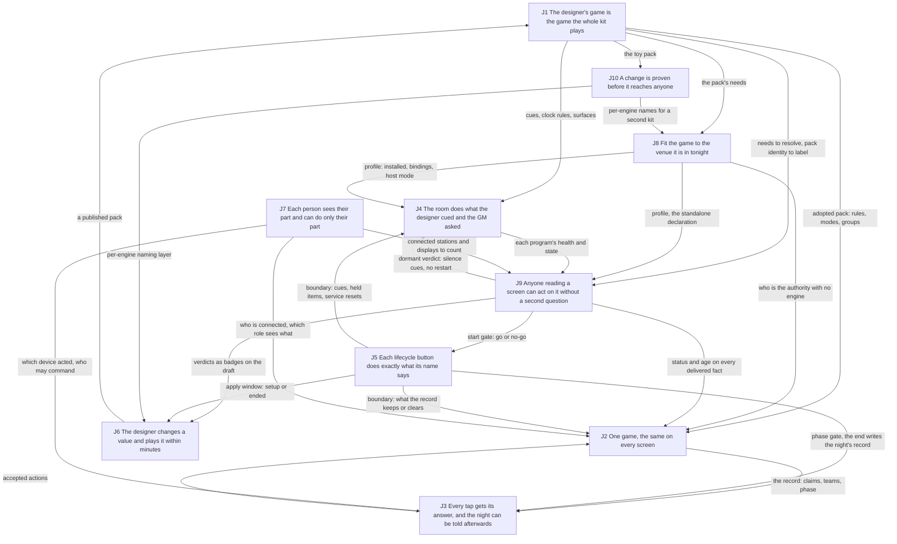
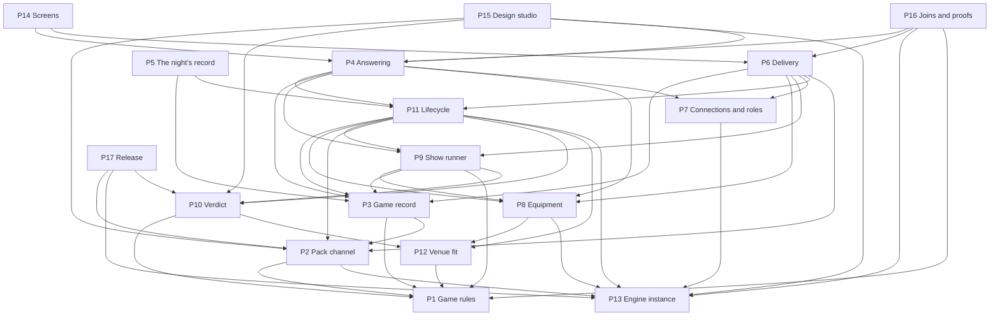
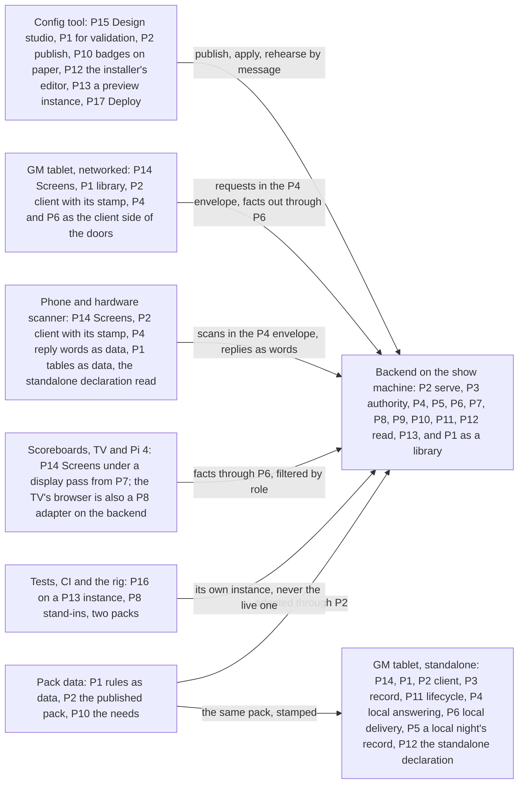

# The engine's shape: how the ten jobs fit together, where each lives today, and a candidate shape to build on for years

**Status: candidate for the owner; nothing decided.** This document closes the relationships level of step 1. It restates the ten jobs from the side of the people the engine serves, draws how the jobs depend on each other, maps where each job lives today at both levels (the big components and the modules inside them), and offers one candidate shape for the engine's parts. Every shape here is a candidate for step 3, and section 6 lists the choices only the owner can make. The owner's frame is decision 26 (`docs/plans/CURRENT-STATE.md` section 0, item 26): design the best architecture for the next iteration of the engine, for long-term use and future development as its use grows beyond ALN; blue's problems are clues, never the driver.

- **Date:** 2026-11-01. **Tree:** `/home/user/ALN-Ecosystem`, branch `claude/nice-curie-hescfv`, HEAD `46fe9840`. Nothing was run except `sed`, `grep` and `ls` to read records and re-check cited code lines. The stale clones beside the repository were not read. `backend/.env` was not opened.
- **Sources and citation keys.** JR = `docs/plans/architecture-pass/relationships/2026-11-01-job-relationships.md` (the jobs said functionally, the eleven shared mechanisms M-A to M-K, the 45 pairs, the dependency drawing). TC = `relationships/2026-11-01-today-components.md` (the big components against the jobs: its sections 2, 3, 5, 6, 7). BM = `relationships/2026-11-01-today-backend-modules.md` (the 90 backend modules: its sections 2 to 7). CM = `relationships/2026-11-01-today-client-modules.md` (the tablet's 77 files, the phone's 4, the hardware scanner's 44, the scoreboard page: its sections 1 to 6). EJ = `2026-10-31-engine-jobs.md` (the ten jobs, the seven questions A to G in its section 4). AN = `2026-10-30-cause-analysis.md` (flaws C1 to C16; section 1 is the short list). SP = `2026-10-31-standalone-pass.md` (the proposed N1; section 5, what it means for the rules). MD = `2026-10-30-map-direction.md` (the five users, the standing rules, the 52 capabilities; "cap 16" is capability 16 in EJ's numbering). CTX = `CONTEXT.md` (sections 0, 2, 4b, 5, 7). CS = `docs/plans/CURRENT-STATE.md`. All records are under `docs/plans/architecture-pass/` unless the path says otherwise. A code citation `path:line` was re-read in this tree today; one followed by "via KEY" is carried from that record.
- **Words.** The design words are exactly as `mattpocock-skills/1.3.1/skills/engineering/codebase-design/SKILL.md` defines them and appear only in the design paragraphs: **module** (anything with an interface and an implementation), **interface** (everything a caller must know, including ordering, error modes and configuration), **implementation**, **depth** (behaviour per unit of interface learned; **deep** is much behind little, **shallow** is an interface nearly as wide as the body), **seam** (the place a module's interface lives, where behaviour can be changed without editing there), **adapter** (a concrete thing that satisfies an interface at a seam), **leverage** (what callers get from depth), **locality** (what maintainers get: change, bugs, knowledge and verification in one place). Domain words are CTX: **authority**, **copy**, **delivery path** (section 4b); **verdict**, **one truth** (section 2); **dormant**, **paper** and **live**, **remote display**, **blue/green** (section 5); **truth sweep** (section 7); **game** is one played game, **standalone** and **networked** are deployment modes (section 1). "Part" is the owner's word for a piece of the engine at either level. In owner-facing text "the engine" is the backend plus everything it drives, "the tablet" a GM scanner, "the phone" the web player scanner, "the hardware scanner" the ESP32.
- **People.** The five users the direction map names (MD:52-57): the designer, the venue installer, the GM, the player, the audience; and the developer who keeps building the engine, whom decision 26 names.

## 1. The ten jobs, said from the side of the people they serve

One line per job: who, at what moment, what must happen. Where EJ's wording names a mechanism rather than a need, a proposed title follows; the restatements are JR section 2's, cut to one line each. J8 and J9 lead because the owner named them as the two understood mechanically.

| Job | Who, when, what must happen | EJ's wording (EJ:34-43) | Proposed title, where the current one is mechanical |
|---|---|---|---|
| J8 | The installer, in the days before an event, states what the kit brings tonight, binds the pack's names to real instruments and gets one go or no-go. A GM running a game with no engine gets a game that knows it is standalone, not one mourning a lost connection. | Run wherever the venue and the game need | **Fit the game to the venue it is in tonight** (the "other kits" clause is a constraint on every job, not a person's need tonight; JR §2 J8) |
| J9 | Anyone reading a screen mid-show can tell, at a glance, whether what they see is current and whether they must act: red means act now, grey means absent on purpose, old looks old; the installer's go is a go; the audience's clock never counts on its own. | Tell the truth about what it knows | **Anyone reading a screen can act on it without a second question** (the four states a fact can be in are the mechanism, a label the fact carries; JR §2 J9) |
| J1 | The designer publishes a game and the whole kit plays that game, that version, with no code change; at doors-open the GM can see that the tablets, the TV and the engine agree, or is refused. A second designer's game runs on the same engine. | Run any game from its pack | **The designer's game is the game the whole kit plays** |
| J2 | Mid-show, whatever the GM did on any tablet is what every tablet, the TV and the audience see, at once and after a tablet comes back; a delete frees the token everywhere, a reset empties every screen; nobody asks which screen is right. | Keep one true record of the game, and show it truly everywhere | **One game, the same on every screen** ("decided in one place" is the design answer, not the need) |
| J3 | At the tap, the GM or the player learns at once whether it counted and why not if it did not; nothing is silently lost or doubled. After the show, the owner and the designer read the night's story from what was captured during play. | Answer every action, and remember what happened | **Every tap gets its answer, and the night can be told afterwards** (two people at two moments; see question D, section 5) |
| J4 | The audience sees the video and hears the music the designer cued, when the game says so; the GM makes the room do a thing and sees it happen, or sees at once that it did not and what to press; a dead program comes back by itself. | Run the show's equipment, and know its true state | **The room does what the designer cued and the GM asked** ("know its true state" is J9's quality applied to equipment; question G) |
| J5 | The GM starts, pauses, ends and resets games trusting that each act does what its name says: an ended game stays ended, the next starts clean, a restart loses nothing, a pause blocks scans; the designer's between-games edit lands in the next game, never the one in progress. | Move each game through its life cleanly | **Each lifecycle button does exactly what its name says** |
| J6 | The designer, in the days before a show, changes one value, applies it and plays a round within minutes, on a laptop or on the show machine between games, and nothing they do can reach the live show or its records. | Let designers build, change and try games safely | kept (already written from the designer's side; JR §2 J6) |
| J7 | The GM alone can start, pause, end and change scores, and the engine knows which tablet did it; the audience sees scores and exposed evidence and nothing else; a player sees the memory they scanned, with no account; a stranger on the venue wifi sees nothing. | Give each person exactly what their role needs, and let each do only what their role allows | kept (widened in EJ question B; JR §2 J7) |
| J10 | The developer who changes the engine learns from a green run, before the show, that the show path still works for ALN and for the toy game; the owner decides when a new version goes to the venue and can swap back by replugging a machine; no test and no rehearsal ever reaches a live show. | Stay trustworthy as it changes | **A change is proven before it reaches anyone, and the owner alone sends it to the show** (two people, two moments; question F) |

Two of the ten are not jobs of the same kind as the other eight. J9 and J10 are qualities that apply across the others: J9 has one mechanism of its own (a fact that carries how sure it is) and otherwise rides on the delivery paths of J2 and J4; J10 has two (checking the joins, keeping engines apart) and otherwise grades every other job. J5 is a third kind: a table of moments that every other job reads (EJ:184; JR §1 item 1). This matters for the shape in section 4: a quality becomes a label every part carries and a proof every part passes, not a part of its own.

## 2. How the jobs relate

### 2.1 In plain words

The engine has a spine and a ring. The **spine** is what happens at a tap in a networked show: the designer's pack (J1) decides the rules, the game record (J2) is what a tap is judged against, the answer (J3) comes back and the accepted tap becomes part of the record, and roles (J7) say who tapped and who may see the result. The **ring** is the engine's own machinery: the room's equipment (J4) reports what it is doing, the installer's profile (J8) says what the room has, the verdict (J9) turns both into go, no-go or dormant, and the life of a game (J5) says when to recompute and what to reset, which feeds back into the equipment. The designer's week (J6) and the developer's proof (J10) touch the show only through the pack and through one naming layer that keeps a second engine apart from the live one (JR §5).

### 2.2 The dependencies, drawn

Twenty-five edges chosen by weight from JR section 4's 45 pairs: the ones whose absence breaks the consuming job tonight. An arrow runs from the job that produces something to the job that consumes it; the label is what crosses.

Counts from JR section 4: 45 pairs, 32 carry a dependency, 43 share at least one mechanism, 10 carry a quality, 4 are thin, none is unrelated. The ring (J4, J8, J9, J5) is also the backend's one require cycle today, seven modules wide, running through the game record (BM §5.1): the ring drawn in code with the spine's record caught inside it.

### 2.3 The shared mechanisms

A mechanism is shared when two or more jobs cannot be done without the same piece of behaviour. JR section 3 named eleven; each is listed here with the jobs that use it and one plain sentence. Four of them have no home today (M-B, M-C, M-G, M-H); three exist and are the best-shaped modules in the tree (M-A, M-F, and M-F's health half); one is not a part at all but a parameter every rule must take (M-K).

| Id | Mechanism, plainly | Jobs that use it | Today |
|---|---|---|---|
| M-A | **The rules.** What a mode means, what a token scores, when a group completes, whether a claim uses the token up, how money is written. | J1 (owner), J2, J3, J4, J8, J9 | Deep and pure in the backend (`backend/src/gameRules/*`, BM §2 rows 5-15); hand-copied on the tablet (`ALNScanner/src/core/scoring.js`, `modeSemantics.js`, `storage/LocalStorage.js`; CM §6.2 R1-R4); the TV reads `game.json` itself (`backend/public/scoreboard.html:1231`) |
| M-B | **Getting a fact onto a screen.** One route per fact, the same for the live change and the catch-up after a reconnect, carrying the fact's label. | J2 (game facts), J4 (equipment), J9 (the label), J1 (pack identity), J7 (filtered by role), J5 (the boundary as a message) | Two builders per fact (`backend/src/websocket/broadcasts.js:183`, `syncHelpers.js:36`), four write rules on the tablet, the TV's own rules (TC §3.2 J2, §3.6); health on a different route from state (RS section 8 Q2 via TC §4.4) |
| M-C | **Knowing who is connected.** A verified pass on every connection, the device's class and name, whether it is still there. | J7 (owner), J2, J3, J8, J9 | Spread over six backend modules; a route default records the hardware scanner as a phone (`backend/src/routes/healthRoutes.js:54`); only a socket calling itself `gm` is asked for a pass (`backend/src/websocket/socketServer.js:53`); five reachability answers across the clients (TC §4.9) |
| M-D | **The boundary table.** At setup, start, pause, end, reset, restart, the next game and a pack change: what each fact and each copy keeps, clears or carries. | J5 (owner, its whole content), J2, J3, J4, J1, J6, J9 | Boot and Reset System as two hand-kept lists (`backend/src/app.js:178-352`, `backend/src/services/systemReset.js:122`; BM §3 J5); the tablet and the TV infer a boundary from a changed session id (`ALNScanner/src/network/networkedSession.js:246`; TC §3.6); player devices never learn one (TC §6.1 split 5) |
| M-E | **Reading and keeping alive an outside program.** One adapter per program, one supervision rule, the engine's picture of it dated. | J4 (owner), J9, J8, J10 | Seven adapters with no interface above them (BM §6); five supervised by `utils/processMonitor`, three spawning their own (BM §3 J4); a private connected flag beside the registry (`backend/src/services/musicService.js:73`) |
| M-F | **The verdict.** What the game needs against what the kit has tonight, one pure function, each line paper or live, three health words. | J9 (owner), J8, J6, J4, J5 | Built and deep: `backend/src/gameRules/resolution.js:31`, `packNeeds`, `preflightService`, `serviceHealthRegistry` (nine ids, `serviceHealthRegistry.js:32`); its result reaches no screen except a session stamp and ack text (TC §2 finding 9) |
| M-G | **Answering a request.** A reply that says which request it answers, whether it is final, and whether anything was stored. | J3 (owner), J2, J4, J5, J7 | Three reply shapes at three doors (BM §3 J3); the tablet matches an acknowledgement by action name alone (`ALNScanner/src/admin/utils/CommandSender.js:44`); the phone and the hardware scanner read one HTTP status differently (CM §6.3 row 7) |
| M-H | **Keeping engines apart.** Every name an engine owns (process files, sockets, ports, data folder, passes, the display it drives) is per engine. | J10 (owner), J6, J8 | Nothing: sixteen fixed `/tmp` literals in eight files, two machine-wide kills (`backend/src/utils/displayDriver.js:147`; BM §5.9); tests adopt the live display and audio (TC §4.10 T1-T5) |
| M-I | **Publishing the pack to every holder.** One list of every copy, one way to fetch it, one notice that it changed, every copy showing which version it holds. | J1 (owner), J6, J5, J2, J9 | Nine holders, no message (TC §6.1 split 1); `grep "pack:changed"` finds no event (BM §3 J1); the config tool's publish tells the engine nothing (TC §3.8) |
| M-J | **Checking the joins.** Every name and shape two parts share is checked against both; fakes against real classes; the same suite on two packs. | J10 (owner), J1, J2, J3, J8 | Three contract tests and the schema tests (TC §7); not joined: the hardware scanner's file shape, a fake against its class, the scoreboard's reading of the snapshot, the media folders against the pack |
| M-K | **The authority switch.** Who decides each fact when there is no engine, and the declared fact that says a game is standalone. | J8 (declares), J2, J3, J5, J9, J1 | A tap (`ALNScanner/src/app/sessionModeManager.js:30`), a URL path (`aln-memory-scanner/js/orchestratorIntegration.js:33-34`), nothing on the hardware scanner, no pack field (SP:19; N1). Not a part: a parameter every rule takes (SP §5, first bullet) |

### 2.4 The qualities that run across jobs

These are not parts. Each is a property every part must have, and the shape in section 4 carries each as a label on a fact, a check in a proof, or a constraint on a name.

| Quality | Plainly | Applies to | Carried by, in the candidate shape |
|---|---|---|---|
| Honesty (J9) | A screen never shows a calm normal value where the truth is "unknown", "old", "broken" or "not installed tonight". | J1, J2, J3, J4, J5, J6 | A label (status, age, paper or live) on every delivered fact (P6) and every reply (P4); the three health words from the verdict (P10) |
| Proof (J10) | A green run means the show path works for two games; no test reaches a live show. | every job | Every part's interface is its test surface (P16); per-engine names (P13); the two-pack run |
| Generic | Nothing in the engine assumes ALN, one kit, one pack or one production (MD:57, MD:59; CTX section 0). | every job | The rules come only from the pack (P1); kit names only from the profile and the engine instance (P12, P13) |
| Authority named with the engine absent | Every rule says who decides when there is no engine; a standalone game is a declared fact, never mixed (CS decision 22; SP §5). | J1, J2, J3, J5, J9 | The same record, lifecycle and answering modules hosted on the tablet (P3, P11, P4); the declaration held by venue fit (P12) |
| Operator floor | Lifecycle, show control and score changes stay in the GM's hands (MD:67; CTX section 6). | J2, J3, J4, J5 | Grants checked once, in the door (P4), from the connection registry (P7) |

## 3. Where each job lives today, at both levels

### 3.1 Jobs against the big components

Codes as TC section 5: **D** decides a fact for that job, **H** holds or shows a copy, **R** carries out on someone else's say-so, **·** not involved. Reproduced from TC's matrix (TC §5) with the outside programs folded into one row.

| Component | J1 | J2 | J3 | J4 | J5 | J6 | J7 | J8 | J9 | J10 |
|---|---|---|---|---|---|---|---|---|---|---|
| Backend | D,R | D,R | D,R | D,R | D | R | D | D | D | R |
| GM scanner, networked | H | D,H | D,R | R,H | D,R | · | R | D | H | R |
| GM scanner, standalone | H | D | D | · | D | · | · | D | H | · |
| Web player scanner | H | D | D,R | R | H | · | R | D | D | · |
| Hardware player scanner | H,R | · | D,R | R | H | · | R | D | D | · |
| TV scoreboard | H,D | H | · | H | D | · | R | · | D | · |
| Pi 4 scoreboard | H,D | H | · | · | D | · | R | R | D | · |
| Config tool | R | · | · | R | · | D | D | R | · | R |
| Pack data and its sync tools | D | · | R | H | · | R | · | H | · | R |
| Tests, CI and the rung-1 rig | R | · | · | R | · | R | · | R | · | D |
| Outside programs (VLC, MPD, PipeWire, Home Assistant, BlueZ, the TV's browser) | · | · | · | D | · | · | · | · | · | · |

Reading the columns (TC §5.1): J3, J5, J8 and J9 each have five deciders, J1 and J2 four. A job with that many deciders is carried by parts that each make their own call. J4's seven deciders are right (the outside programs decide what they are doing); the fault is in how the engine reads them. J6 and J10 each have one decider that cannot reach the part it affects. J5 is not meant to have a decider at all.

### 3.2 Jobs against the modules

Backend groups are TC section 3.1b and BM section 3; client groups are TC section 3.2b and CM section 6.1. A group is named once under the job it mainly serves, with its other jobs in brackets.

| Job | Backend modules | GM scanner modules | Player devices and scoreboard |
|---|---|---|---|
| J1 | `services/packService`, `tokenService`, `profileService`; `gameRules/` (`scoring`, `duplicatePolicy`, `modeSemantics`, `formatting`, `cueValidation`, `packNeeds`, `resolution`, `grants`, ...); `routes/packRoutes`, `resourceRoutes` (26 of 90 files, BM §3 J1) | `core/packLoader` (deep), `tokenManager` (fan-out), `scoring`, `modeSemantics`, `strings`, `theme`, `utils/formatCurrency` (CM §2.2) | Phone `js/app.js` (reads its own nested token file); hardware `TokenService.h`, `AssetService.h`, `AssetManifestDiff.h`; scoreboard's configuration and evidence-mode sections (CM §3-5) |
| J2 | `sessionService`, `transactionService`, `session/*`, `models/*`, `websocket/broadcasts`, `syncHelpers`, `deviceTracking`, `deviceHelpers`, `scoreboardControlService` (38 of 90, BM §3 J2) | `core/unifiedDataManager` (about 55 methods), `storage/NetworkedStorage`, `storage/LocalStorage` (standalone authority), `stateStore`, `teamRegistry`, `network/messageRouters`, `ui/renderers/GameOpsRenderer` | Phone's seen set (`js/app.js`); scoreboard's state, countdown, evidence, ticker and socket sections |
| J3 | `routes/scanRoutes` (inline game logic), `websocket/adminEvents`, `commandExecutor` (64 actions, six jobs), `offlineQueueService` (unwired), `websocket/scanResponse`, `utils/validators`, `responseBuilder` (18 of 90) | `app/domains/gameOps` (first verdict), `network/networkedQueueManager` (deep), `admin/utils/CommandSender`, `ui/uiManager` (result screen), `core/sessionReportGenerator` | Phone `orchestratorIntegration` (deep), `scannerCore`; hardware `Application.h` (scan decision, 1,656 lines), `OrchestratorService.h` (five roles), `ScanResponse.h`, `PayloadBuilder.h`, `BatchId.h` |
| J4 | Seven adapters (`vlcMprisService`, `musicService`, `audioRoutingService` with `audio/*`, `soundService`, `bluetoothService`, `lightingService`, `utils/displayDriver`); orchestrators `videoQueueService`, `displayControlService`, `cueEngineService` with `cue/*`, `heldItemsStore`, `gameClockService`, `cueEngineWiring`; `utils/processMonitor`, `dbusSignalParser` (40 of 90) | Twelve `admin/*` controllers (one line per command), `MonitoringDisplay`, nine renderers, `domains/showControl` and `environment` (pass-through and empty) | Phone and hardware video-unavailable treatment; scoreboard display-mode overlay |
| J5 | `app.js` boot, `server.js` shutdown, `systemReset`, `sessionService` lifecycle methods, `persistenceService`, `storage/*`, `websocket/listenerRegistry` (26 of 90) | `domains/gameAdmin` (four standalone branches), `networkedSession` (boundary inference), `unifiedDataManager.resetForNewSession`, `services/StateValidationService`, `SessionRenderer`, `GameAdminRenderer` | None by design on the player devices (queues and seen sets outlive every game); scoreboard's session-boundary section |
| J6 | No main-job module (BM §3 J6); `packService`'s gate, `gameRules/cueValidation`, `/api/vocabulary`, `musicRoutes` | None | None. The config tool: `lib/publish.js`, `draftStore.js`, `configManager.js`, `toolAuth.js`, in-process imports of engine code (TC §3.8) |
| J7 | `gameRules/grants`, `middleware/auth`, `routes/adminRoutes`, `websocket/gmAuth`, `socketServer`; the floor checked in three places (18 of 90) | `network/orchestratorClient`, `connectionManager`, `ui/connectionWizard` (station name from a list), `utils/jwtUtils`, `ui/settings` | Phone device id and the literal team `'001'`; hardware `ConfigService.h`; scoreboard's device-identity and authentication sections |
| J8 | `app`, `config/index`, `server`, `discoveryService`, `profileService`, `utils/timezone`; kit names in at least 12 files (21 of 90, BM §3 J8) | `app/sessionModeManager` (the tap), `initializationSteps`, `utils/config`, `connectionWizard`, 15 `isStandalone()` branches in five modules (CM §1 item 4) | Phone `scannerCore.isStandaloneMode`; hardware `ConfigService.h`, `Config.h`, `config.h`, `SDCard.h`; no standalone path on the hardware scanner |
| J9 | `serviceHealthRegistry` (20 importers), `dormancyService`, `preflightService`, `gameRules/resolution`, `packNeeds`, `endpointServices`, `dormancyWording`, `routes/healthRoutes` (31 of 90) | `ui/renderers/HealthRenderer`, `dormancyWording` (a parity copy), `connectionManager`, `StateValidationService`; `stateStore` holds no age | Phone's poll and "Offline" word; hardware `ConnectionState.h`, `StatusScreen.h`, `ScanFailedScreen.h`; scoreboard's connection-status section and a countdown that keeps ticking |
| J10 | `storage/MemoryStorage` (the one test adapter), `listenerRegistry` (test-only cleanup), fixed names in eight files (13 of 90) | `MESSAGE_TYPES` export, `_resetForTesting` hooks, `IStorageStrategy`, the parity copy of `dormancyWording` | Phone `scannerCore` (pure, extracted for tests); hardware's seven natively tested headers and `SerialService.h`; the scoreboard tested only through the backend's browser tests |

### 3.3 The tangles

A tangle is one of three things: one job spread over many modules with nothing joining them; one module doing many jobs; or a dependency running against the grain. Each is tied to the flaws it causes. The flaw ids are AN section 1's and SP section 3.4's.

| # | Tangle | Kind | Evidence | Flaws it causes |
|---|---|---|---|---|
| T1 | **The pack is held in nine places and nothing joins them.** The backend's frozen snapshot and the live disk bytes under it, the tablet's cache, the phone's nested file, the hardware scanner's SD copy, the TV's own fetch, the config tool's tree, the sync script's output, the nested submodules, media in three folders. No message says the pack changed. | one job, many holders, no join | TC §6.1 split 1 and 12; BM §3 J1 (tokens reach the engine by five routes); `scoreboard.html:1231` | C12, C14, N1 |
| T2 | **The game's facts are decided once and re-decided in five parts.** The tablet marks the claim, computes the points and shows "complete" before the engine answers (`ALNScanner/src/app/domains/gameOps.js:329-331`); the phone and the hardware scanner decide whether a token exists; the TV decides the evidence rule; the standalone tablet decides everything from a hand-kept copy of the rules. Eighteen rules are re-decided on clients; for five of them nothing keeps the copies equal. | one job, many deciders | TC §2 finding 1; CM §1 items 1-2, §6.2 R1-R18 | C1, C9, C11, C6 |
| T3 | **One fact, two builders; state and health on two routes.** For seven facts the catch-up snapshot and the live event are built by different code; a service's state and its health arrive as separate pushes; no fact carries an age, and no client reads the ages that exist. | the delivery mechanism implemented inline, twice, in two jobs' modules | `backend/src/websocket/broadcasts.js:183` and `syncHelpers.js:36`; RS section 8 Q2 via TC §4.4; BM §3 J2 | C6, C2, C10 |
| T4 | **Three doors, three reply shapes, acknowledgements matched by name.** Player scans get inline JSON, GM scans a socket result or an `error` event, commands `{success, message}`; the tablet matches an acknowledgement to a request by the action name alone; the phone and the hardware scanner classify the same HTTP status differently. | the answering mechanism absent; one module (`commandExecutor`) serving six jobs | BM §3 J3, §4; `ALNScanner/src/admin/utils/CommandSender.js:44`; CM §6.3 row 7 | C7 |
| T5 | **Who is connected has no home.** The handshake asks a pass only of a socket that calls itself `gm`; the TV asserts `gm`; `GET /api/state` and `sync:request` need no pass; `/health` registers a device and defaults its type to `player`; the config tool runs a second login against the same password file; five clients each draw their own reachability word. | one mechanism spread over six backend modules and every client | `backend/src/websocket/socketServer.js:53`; `backend/src/app.js:116`; `backend/src/routes/healthRoutes.js:54`; TC §6.1 split 7; TC §4.9 | C13, C10 |
| T6 | **The life of a game is carried in six places and owned by none.** Boot and Reset System are two hand-kept lists; thirteen services each have a `reset()`; the record calls into the show from five places and the show calls back, a seven-module require cycle; the tablet and the TV infer a boundary from a changed id; the player devices' queues outlive every game; the listener registry removes listeners only under test. | one job in many places; a dependency cycle through the record | `backend/src/app.js:178-352`; `backend/src/services/systemReset.js:122`; BM §5.1, §5.7 (wiring bags at about ten sites, music left out of one); `backend/src/websocket/listenerRegistry.js:13`; `ALNScanner/src/network/networkedSession.js:246` | C4, C5, C1, C6 |
| T7 | **Equipment: seven adapters, no interface above them, a cached picture with no age.** Each program is read by parsing text or an event stream; "is a video playing" has several answerers; held cues and held videos live in two stores; music keeps a private connected flag beside the shared registry; supervision has two shapes. | one job with no shared seam; several answerers of one question | BM §3 J4, §6 (seams); `backend/src/services/musicService.js:73`; `backend/src/utils/processMonitor.js:180` | C3, C11, C2 |
| T8 | **The engine assumes it owns the machine, and tests assume they may use it.** Sixteen fixed `/tmp` names, two machine-wide kills, media folders under `public/`, kit names in at least 12 files; tests adopt the live display, audio and Bluetooth and write placeholder videos into the live media folder. | a missing mechanism (per-engine names); a part doing harm to another's job | BM §5.9; `backend/src/utils/displayDriver.js:147`; TC §4.10 T1-T5, §6.2 M6-M7 | C8, C15 |
| T9 | **The tablet is a command center and a second engine in one, and the standalone choice is not a seam.** Four files carry a second copy of the rules; 30 of 67 files would carry a standalone game; the strategy seam covers storage only, and 15 `isStandalone()` branches in five modules ask the mode directly; the four domain objects reach every collaborator through a back-reference to `App`; three layer inversions make dependencies run both ways. | one module doing many jobs; dependencies against the grain | CM §1 items 3, 4, 9, §6.4; TC §2 finding 3; SP section 1 (nothing under `ALNScanner/src` imports `backend/src/gameRules/`) | C9, N1, C14, C11 |
| T10 | **The config tool reaches the engine by file and by import, never by message.** It writes `backend/.env`, the routing file and the media folders; imports engine modules by relative path; runs the engine's pack check as a child process; an edit becomes visible at the engine's next restart. No apply step, no preview engine, no statement of where one would run. | a dependency on the engine's implementation, not an interface; a job (J6) with an author surface and no apply | TC §3.8, §6.1 split 6, §6.3 last bullet; `config-tool/server.js:47` | C12, C8 |
| T11 | **Joins kept by hand, fakes unchecked, tests per part.** Twelve test configurations by part, three contract tests pin joins, nothing checks the hardware scanner's token-file shape against the pack, a fake against its class or the scoreboard's reading of the snapshot; the deployed game is several checkouts, a built folder and hand-copied media nothing compares. | the join-checking mechanism absent; a quality graded per part | TC §3.10, §7 (last paragraph); AN C14, C15, C16 | C14, C16, C15 |
| T12 | **Shallow chains and thick doors.** "Skip video" crosses five tablet modules to reach one deep one; `commandExecutor` is a dispatch table serving six jobs; `routes/scanRoutes` decides token existence, session existence and video eligibility inline and holds a batch cache lost at restart; the composition is written by hand at about ten sites. | shallow modules with wide interfaces; routes holding game logic | CM §1 items 5, 11; BM §4, §5.4, §5.7; `backend/src/routes/scanRoutes.js:183` | C11, C5, C7 |
| T13 | **The scoreboard page is one file, two deployments, and sits on both sides of the engine.** 1,860 lines with no module boundary; it decides the evidence rule and the money format from a file it fetched; it extrapolates the countdown and keeps counting after a disconnect; the engine launches, shows, hides and kills its browser as an outside program while the page is a client of the engine's socket under a pass minted into the page text. | one module doing many jobs; a part on both sides of a seam | CM §1 item 8, §5; TC §3.6, §3.7, §6.1 split 11; `backend/src/utils/displayDriver.js:77`; `backend/src/routes/resourceRoutes.js:204-205` | C12, C10, C13, C11 |

What the tangles have in common, in design words: the spread is in the **shared mechanisms**, not in the jobs. The six backend modules that serve five or six jobs (`commandExecutor`, `sessionService`, `broadcasts`, `cueEngineService`, `videoQueueService`, `transactionService`; BM §4) each hold one of M-B, M-D or M-G inline, so a change to how a fact reaches a screen lands in a listener list, a snapshot builder and three tablet routers instead of one place. The modules that already are shared mechanisms done right, `gameRules/*`, `resolution`, `packNeeds`, `serviceHealthRegistry`, `duckingEngine`, `standingEvaluator`, `timelineRuntime`, `processMonitor`, are deep, pure where they can be, pass the deletion test and are the easiest to test (BM §7 item 1). They are the pattern the candidate shape follows.

## 4. A candidate shape

The rule for the shape: **one part per job or per shared mechanism; the parts depend in one direction; a quality is a label every part carries and a proof every part passes, not a part.** Seventeen parts at the module level. For each: the people it serves, its interface in plain words, its seams and adapters, the jobs it serves, the flaws it removes, and the planned capabilities it makes room for. Where a real alternative exists, section 4.4 gives both and says what each costs.

### 4.1 The parts, one by one

**P1. Game rules** (M-A; J1's rules half). *Plainly:* the pack's rules as one body of pure functions that both the engine and a standalone tablet run: what a mode means, what a token scores, when a group completes, whether a claim uses the token up, which phases allow a scan, how money is written, what a cue is allowed to do. *Interface:* `rulesFor(pack)` returning a small set of pure functions over plain token, transaction and mode fields; no I/O, no engine state. *Seams and adapters:* one implementation, two hosts (the backend in a networked game, the tablet in a standalone one); the hardware scanner, which cannot share JavaScript, receives the rules it needs (id normalisation, media extension, reply words) as data tables generated from P1 rather than a hand-written C++ twin. *Serves:* J1 (owner), J2, J3, J4, J8, J9. *Removes:* C9 (the client runs the engine's functions, or none), C14 (one shape, not two), C11 (one answerer for "what does this mode do"). *Makes room for:* caps 1, 2, 36, 37, 38 (the second game's scoring and hidden-state rules arrive as pack data read by the same functions), 49, 50. *Depth today:* the backend half is deep (`backend/src/gameRules/*`, BM §2 rows 5-15); the tablet's twin is the second implementation at the same seam with no shared code (CM §6.2).

**P2. Pack channel** (M-I; J1's travel half). *Plainly:* one list of every holder of the pack, one way to fetch it, one notice that it changed, and a version stamp every copy shows and every game record carries. *Interface:* `adopt(packRef)` once per boundary; `current()` with identity; `holders()`; `onChanged`; a per-file fetch with fingerprint check. *Seams and adapters:* the pack source (a folder on disk, the config tool's draft store, the toy packs in tests); the pack's media named by fingerprint and checked against the bundle (CTX section 0, "Media bundle"). *Serves:* J1, J6, J5, J2, J9. *Removes:* C12 (one adopt moment, one notice, one stamp compared at connect), C15's media half (every named file checked), N1's pack half (the place a declared standalone fact could live, if the owner puts it there). *Makes room for:* caps 3, 16 (hot-apply is `adopt` called at a P11 window), 40, 41. *Today:* the tablet's `packLoader` is the best-shaped client pack module and the three other clients bypass it (CM §1 item 6).

**P3. Game record** (J2's authority). *Plainly:* the one place the game's facts are decided: teams, claims, scores, exposed evidence, player scans, the phase; it takes an action in and gives back the facts that changed, each dated. *Interface:* `apply(action) → outcome` (accepted, refused with a reason, duplicate), `read(fact)`, `changes since`; claims derived from the transactions, not kept beside them. *Seams and adapters:* persistence (file, memory) as today's one real seam (BM §6, storage row); the host (the backend in a networked game, the tablet in a standalone one, by the authority switch M-K). *Serves:* J2 (owner), J3, J5. *Removes:* C1 (no copy keeps a claim list; a claim is read from the record), C11 ("which teams exist", "may I scan" have one answerer), C9 (clients read outcomes, they do not pre-judge). *Makes room for:* caps 27 (the phase as a fact the GM writes), 30, 35, 38 (hidden facts with one home and engine-side filtering through P6). *Today:* `sessionService` plus `transactionService` plus `models/session`, one object holding nearly every fact (BM §3 J2), and the tablet's `LocalStorage` as a second authority (CM §2.2).

**P4. Answering** (M-G; J3's tap half). *Plainly:* every request, from a tap or a button, over HTTP or the socket, gets one reply in one shape: which request it answers, the outcome word (accepted, refused and why, held, try again), whether it is final, and whether anything was stored. *Interface:* `answer(request) → reply`; the request carries its id and the device that sent it; the reply's outcome words are a closed list the clients read as data. The operator floor is checked here, once, from P7's grants. *Seams and adapters:* two transports (HTTP, socket) as adapters to one door; the clients' reply classifiers generated from the same word list (the phone's `scannerCore.classifyScanResponse` and the hardware scanner's `ScanResponse.h` become one table). *Serves:* J3 (owner), J2, J4, J5, J7. *Removes:* C7 (every reply says request, final, stored), C13's floor half (one check, not three), C11 (one dispatch for commands and scans). *Makes room for:* caps 14 (a held cue is an answer the GM sees), 36 (compound actions are requests with the same envelope). *Today:* `commandExecutor`, `adminEvents`, `scanRoutes` and `scanResponse` (BM §3 J3; T4, T12).

**P5. The night's record** (J3's afterwards half). *Plainly:* when a game ends, one structured record of the night is written from the facts the engine decided, with the roster, the GM's notes, the accusation and later photos captured into it during play; the owner and the designer read the night from it. *Interface:* `capture(item)` during play; `close(game) → bundle` at the end moment; `read(bundle)`. *Seams and adapters:* the bundle contract (`backend/contracts/session-bundle.schema.json`) as the written shape; the Review stage reads it. *Serves:* J3's second half, J6 (Review), J5 (the end moment). *Removes:* C11's report half (one total, from the record, not two from copies). *Makes room for:* caps 30, 31, 32, 33, 34. *Today:* nothing writes it; the tablet's `sessionReportGenerator` builds markdown from its own copies (CM §2.2).

**P6. Delivery** (M-B). *Plainly:* one route per fact from where it is decided to every screen that may see it, the same route for the live change and for the catch-up after a reconnect, every fact carrying its label (what it is, how old, how sure) and filtered by the reader's role. *Interface:* `publish(fact, value, label)` from the authorities; `snapshot(for connection)` and `live(for connection)` built by the same per-fact builder; the ten service domains and the game facts are both facts here. *Seams and adapters:* the transport (socket rooms today, anything later); the role filter from P7. *Serves:* J2, J4, J9, J1, J7, J5. *Removes:* C6 (one builder per fact), C2 (a service's state and health are one fact with one route), C10 (the label is part of the fact, so a screen can draw "old" or "unknown"), C14's wire half (the shape is written once and both sides read it). *Makes room for:* caps 15, 28 (the truth sweep becomes a check that every screen draws the label), 39 (remote displays receive the same facts under a display pass), 35. *Today:* `broadcasts.js` (41 listener sites) and `syncHelpers.buildSyncFullPayload`, two builders per fact (T3).

**P7. Connections and roles** (M-C; J7). *Plainly:* every connection, from a tablet, a display, a phone, a hardware scanner or the config tool, presents a verified pass; the engine knows what class it is, its name, which role it has and whether it is still there, by one liveness rule. *Interface:* `admit(pass, claim) → connection` (class, name, grants); `alive(connection)`; `list()`; `grants(connection, action)`. *Seams and adapters:* the pass (operator, observe, device, session tiers); the transports. *Serves:* J7 (owner), J2, J3, J8, J9. *Removes:* C13 (a client's word decides nothing; a route default records nothing), C10's reachability half (one answer to "is it there"). *Makes room for:* caps 12, 13, 35, 39 (a `display.remote` count the preflight can read). *Today:* `middleware/auth` and `gameRules/grants` are deep; the registry of who is connected is spread over six backend modules (BM §3 J7; T5).

**P8. Equipment** (J4's instruments; M-E). *Plainly:* each thing the room can do (play a video, play music, play a sound, route and set a volume, light a scene, show a display) behind one interface, with the outside program as an adapter beneath it; the engine's picture of each program is dated and reconciled against the program itself; one supervisor restarts what it can and reports what it cannot. *Interface:* per capability, a handful of verbs and `state() → {value, health, age}`; `supervise(program, host mode)`. *Seams and adapters:* one per program (VLC, MPD, PipeWire, `pw-play`, BlueZ, Home Assistant, the TV's browser) and one software stand-in per capability for the preview engine and the rung-1 rig. *Serves:* J4 (owner), J9, J8, J10. *Removes:* C3 (the picture carries an age and is reconciled), C2's source half (state and health are one object here, delivered by P6), C11's equipment half ("is a video playing" has one answerer). *Makes room for:* caps 9, 10, 11, 39, 40. *Today:* seven adapters with no interface above them, two supervision shapes, one private connected flag (BM §6; T7). Section 4.4 gives the alternative: an interface per program instead of per capability.

**P9. Show runner** (J4's conductor). *Plainly:* the designer's cues, the game clock, the video queue and the held items: what the room should be doing now, given the game's events and the GM's commands, and what is parked because a service is down or a video is busy. *Interface:* `onGameEvent`, `tick`, `fire(cue)`, `hold/release`, `queue(video)`; one held store; it reads P8's dated picture and never keeps its own. *Seams and adapters:* the cue vocabulary from the pack (P1); the clock rules from the pack. *Serves:* J4, J5, J1. *Removes:* C11's held half (one store for cues and videos), C3's trust half (it reads a dated picture and acts on age). *Makes room for:* caps 8 (dormancy silences cues here), 14, 27 (phase-relative cue timing). *Today:* `cueEngineService` with `cue/*`, `heldItemsStore`, `videoQueueService`, `displayControlService`, `gameClockService`, with two held stores and five callers of "is a video playing" (BM §3 J4).

**P10. Verdict** (M-F; J9's one mechanism). *Plainly:* what the game needs against what the kit has tonight, as one pure function whose every line says paper or live, go, no-go or dormant; the editor, the preflight, the start gate and a cue-time refusal all quote it. *Interface:* `resolve(needs, profile, inventory) → verdicts`; `needsOf(pack)`; the three health words. Pure: the caller gathers the live inventory from P8 and passes it in. *Seams and adapters:* none needed; it is data in, data out. *Serves:* J9 (owner), J8, J6, J4, J5. *Removes:* C10's profile half (a missing or broken profile is a failed check, never "nothing installed"). *Makes room for:* caps 6, 7, 8, 19, 25. *Today:* built and deep (`backend/src/gameRules/resolution.js:31`, `packNeeds`, `preflightService`, `serviceHealthRegistry`); the missing half is P6 carrying its output to a screen (TC §2 finding 9).

**P11. Lifecycle** (M-D; J5). *Plainly:* the table of moments against facts (setup, start, pause, end, reset, restart, the next game, a pack change) and the only code that moves a game from one moment to the next; boot and Reset System are the same path; every screen is told the boundary rather than guessing it from a changed id. *Interface:* `move(game, to moment)`; the table as data; `onBoundary` for P6 to publish. It is the only caller of every part's reset and of the cascades into clock, cues, music, preflight and dormancy. *Seams and adapters:* the host (backend or standalone tablet, the same table). *Serves:* J5 (owner), J2, J3, J4, J1, J6, J9. *Removes:* C4 (every fact has a fate in the table), C5 (one path for boot and reset, one composition list), C1's reset half (the boundary carries a version every copy compares), C6's restore half (a restore fires the same publishes a live change would). *Makes room for:* caps 16 (the apply window is a row of the table), 18, 27, 44, 46 (reset is one code path in tests and in production). *Today:* `app.js` boot, `systemReset`, `sessionService`'s lifecycle methods, thirteen `reset()` methods, the seven-module cycle (T6).

**P12. Venue fit** (J8; M-K's home candidate). *Plainly:* the installer's profile: what the kit brings tonight, which real instrument each of the pack's names binds to, whether the engine starts or adopts each program, how many stations and remote displays to expect; and the declared fact that a game runs with no engine. *Interface:* `profile()`, `binding(role)`, `hostMode(program)`, `standalone()`; read once per engine start, edited only by the installer's tool. *Seams and adapters:* the profile file (today `PROFILE_PATH`), simulation and preview profiles as adapters of the same shape. *Serves:* J8 (owner), J4, J9, J2, J5. *Removes:* N1 (the declaration exists and every device reads it), C10's "not installed" half, C15's host half (program names and install commands per machine, not per OS release in code). *Makes room for:* caps 5, 10, 21, 22, 23, 24, 25, 43, 49. *Today:* `profileService` (deep, read once) and kit names in at least 12 files (BM §3 J8).

**P13. Engine instance** (M-H; the composition root). *Plainly:* one engine knows its own names (data folder, process files, sockets, ports, the display it drives, the passes it accepts) and builds its parts once from one list, so a second engine on the same machine (a test, a preview, a second kit) never touches the first. *Interface:* `instance(config) → names`; `compose(instance) → the wired parts`, used by boot, by Reset System and by tests. *Seams and adapters:* the environment (the `.env` file, a test's overrides, a preview's). *Serves:* J10 (owner), J6, J8, J5. *Removes:* C8 (no fixed name, no machine-wide kill), C5's wiring half (one composition list, nothing left out), C15's install half. *Makes room for:* caps 20, 42, 46. *Today:* nothing; sixteen fixed names, two machine-wide kills, composition written by hand at about ten sites (BM §5.7, §5.9).

**P14. Screens** (the client side of P4 and P6). *Plainly:* a screen draws the facts it is delivered, with their labels, and sends requests in the one envelope; it keeps no rule copy and makes no verdict of its own. The GM's four sections, the scoreboard page, the phone's memory view and the hardware scanner's display are each a Screens adapter. *Interface:* `render(fact, label)` per fact; `send(request) → reply`; a connection from P7. *Seams and adapters:* one per device class; the scoreboard page becomes one adapter in two hosts (the TV's browser and the Pi 4). *Serves:* J2, J4, J9, J3, J7. *Removes:* C9's client half (no pre-judging), C10's drawing half (the label is drawn), C14's client half (renderers read what P6 defines). *Makes room for:* caps 26, 27, 29 (screen baselines against one renderer per fact), 35, 39. *Today:* the tablet's renderers, `stateStore`, `messageRouters` and four write rules; the scoreboard's seventeen sections sharing one `state` object (CM §5).

**P15. Design studio** (J6). *Plainly:* the designer's drafts, published through the engine's own gate, applied to a running engine through P2 at a window P11 allows, rehearsed on a preview engine that P13 keeps apart from the live one, with verdict badges from P10 on the draft. *Interface:* `draft`, `publish`, `apply`, `rehearse`; it talks to the engine by message (P4's door), never by file or import. *Seams and adapters:* the draft store; the preview engine as a second P13 instance under a preview profile (P12). *Serves:* J6 (owner), J1, J9. *Removes:* C12's publish half (publish and apply are messages the engine answers), C8's preview half (a preview engine has its own names). *Makes room for:* caps 4, 16, 17, 18, 19, 20, 21, 41, 48, 52. *Today:* the config tool authors and publishes by file and import with no apply step (T10).

**P16. Joins and proofs** (M-J; J10's quality). *Plainly:* every shape two parts share is written once and both sides read it; every fake is checked against the class it stands for; the same suite runs on two packs; every rung runs the real stack with the physics it has, under its own engine instance, so no test reaches a live show. *Interface:* contracts generated from P4's reply words and P6's fact shapes; a conformance test per adapter at each seam; the two-pack matrix; rung profiles. *Seams and adapters:* P13's instance for every test run; P8's stand-ins for the rig. *Serves:* J10 (owner), J1, J2, J3, J8. *Removes:* C14 (shapes generated, not hand-kept), C16 (fakes checked, skips loud, coverage per path from authority to screen), C8's test half. *Makes room for:* caps 28, 29, 46. *Today:* three contract tests, twelve test configurations by part, tests on the live machine (T11).

**P17. Release** (J10's release-day half, or J8's Deploy chain). *Plainly:* what is installed on a machine is one described set (engine version, built client folders, pack version, media by fingerprint, profile) that the engine compares at start and reports, so a rollback moves everything or says what it did not. *Interface:* `describe(machine) → manifest`; `check(manifest) → verdicts` (through P10's words). *Seams and adapters:* blue/green (CTX section 5) as the cutover; the manifest as the one list. *Serves:* J10, J8, J1. *Removes:* C15 (installed pieces compared, nothing hand-run and unchecked). *Makes room for:* caps 22, 44, 45, 47, 51. *Today:* several checkouts, a symlinked `dist`, hand-copied media (TC §4.7 A3, §6.1 split 12).

Every flaw lands on at least one part: C1 (P3, P11), C2 (P6, P8), C3 (P8, P9), C4 (P11), C5 (P11, P13), C6 (P6, P11), C7 (P4), C8 (P13, P15, P16), C9 (P1, P3, P14), C10 (P6, P7, P10, P12, P14), C11 (P1, P3, P4, P5, P8, P9), C12 (P2, P15), C13 (P4, P7), C14 (P1, P6, P14, P16), C15 (P2, P12, P13, P17), C16 (P16), N1 (P2, P12).

Every job lands: J1 (P1, P2), J2 (P3, P6, P14), J3 (P4, P5), J4 (P8, P9), J5 (P11), J6 (P15), J7 (P7), J8 (P12, P17), J9 (P10 and the label carried by P4, P6, P14), J10 (P13, P16, P17). Every shared mechanism lands: M-A P1, M-B P6, M-C P7, M-D P11, M-E P8, M-F P10, M-G P4, M-H P13, M-I P2, M-J P16, M-K a parameter declared by P12 and taken by P3, P4, P11, P14.

### 4.2 How the parts depend on each other

One direction, no cycles. The pure parts sit at the bottom (P1 rules, P10 verdict), the engine's own names beside them (P13), the installer's profile above the rules (P12), then the pack channel and the connection registry, then the three stateful cores (P3 record, P8 equipment, P9 show runner), then the lifecycle that moves them (P11), then the two doors every screen uses (P4 in, P6 out), then the night's record, and at the top the studio, the proofs and the release, which touch the engine only through its doors and its names. The ring of section 2 (equipment, profile, verdict, lifecycle) is broken by making P10 pure: the lifecycle gathers P8's picture and P12's profile and hands both to P10; P10 reaches into nothing.

An arrow means "depends on". A topological order exists (P1, P13, P12, P2, P10, P7, P8, P3, P9, P11, P4, P6, P5, P14, P15, P16, P17), so there is no cycle; the script in section 7 checked it. Three of today's upward edges are gone by construction: services no longer reach into `websocket/` (BM §5.2) because P6 is above every authority; routes hold no game logic (BM §5.4) because P4 is one door above P3; and the record no longer calls the show from five places (BM §5.1) because P11 is the only mover and sits above both.

What each seam gives, in design words. **Leverage:** one P1 implementation pays back across the engine, the standalone tablet and the data tables for the hardware scanner, and across every test of scoring; one P6 builder per fact pays back across the live push, the snapshot, every renderer and the contract. **Locality:** a change to how a fact reaches a screen lands in P6 alone; a change to a boundary's fate lands in P11's table alone; a change to a reply's meaning lands in P4's word list and every classifier regenerates. **Testability:** each part's interface is its test surface; P1 and P10 are pure; P3, P9 and P11 accept their collaborators; P8's stand-ins are adapters at a real seam (two adapters, the program and the stand-in, so the seam is real by the skill's rule); P13 makes every test run its own engine. The deletion test holds for every part: delete P6 and a route per fact reappears in six jobs; delete P11 and thirteen resets and two wiring lists reappear; delete P4 and three reply shapes reappear; delete P13 and sixteen fixed names reappear.

### 4.3 The component level: which parts run where

**The backend** runs every part except the studio, the proofs and the release, and is the authority host for P3 in a networked game. It serves the pack (P2), admits every connection (P7), answers through one door (P4) and delivers through one (P6). What leaves it: the scoreboard page's rules (the evidence filter and money format move to P1 and P14), the minting of a pass into page text (P7 issues passes to connections), the device registry inside `/health` (P7), the config tool's files (P15 talks by message). *Jobs:* all ten, as today, but each in one part.

**The GM tablet, networked,** is a Screens adapter (P14) plus the client side of the two doors, with the same P1 library for drawing and the same P2 client for its pack copy and stamp. It keeps no claim list, computes no points before the reply and infers no boundary; the result screen draws P4's reply and P6's facts. The twelve one-line controllers and the five-hop command chain collapse into P14's `send` (CM §1 item 5). *Jobs:* J2, J3, J4, J9 as a reader; J7 as a connection.

**The GM tablet, standalone,** is the same app with the authority switch set: it hosts P3 (the record), P11 (the lifecycle table), P4 (local answering, so a refused scan is refused on screen too), P6 (local delivery to its own screens), P1 (the same rules) and a local P5 (a night's record with no player scans unless a standalone player device delivers them, which is one of the owner's choices). It reads the standalone declaration from P12 and shows "standalone", never "disconnected". **What it needs to run a standalone game:** P1, P2 client, P3, P4, P5, P6, P11, P12's declaration, P14, and nothing from P7, P8, P9 or P10 beyond a readiness word. Today 30 of the tablet's 67 files carry a standalone game through a hand-kept second engine (CM §6.4); in the candidate they carry the same modules the backend runs, which is the parity SP section 5 asks for. *Jobs:* J1, J2, J3, J5, J8, J9.

**The player devices** (the phone and the hardware scanner) are Screens adapters with a P2 client (pack copy and stamp), P4's reply words as a generated table, P1's id and media rules as generated data, and the standalone declaration read from the pack copy or the engine. The phone and the hardware scanner stay equal by sharing data, which is the only sharing JavaScript and C++ allow (CM §6.3). *Jobs:* J3, J1, J7 (a device pass), J8, J9.

**The scoreboards** (the TV and the Pi 4) are one Screens adapter under a display pass from P7, drawing team totals, exposed evidence and the clock as P6 delivers them with their labels; the page decides nothing. The TV's browser is also a P8 adapter on the backend side (the display capability), which is the one component on both sides of a seam and is now described on both. *Jobs:* J2, J7, J9 as readers.

**The config tool** hosts P15 and the installer's P12 editor, with P1 for validation, P2 for publish, P10 for badges (paper, on the draft) and P17 for the Deploy stage; it rehearses on a second P13 instance. It talks to the running engine only by message through P4's door, so a publish can carry "apply at the next window" and the engine can refuse. *Jobs:* J6, J8, J1, J9, J10's release half.

**Tests, CI and the rig** are P16 on P13 instances, with P8's stand-ins and the two packs. No test adopts the live display, audio, Bluetooth or media folders, because no test runs under the live instance's names. *Jobs:* J10, J1, J8.

**The pack data** stays what it is (CTX section 0): the game's definition, read by P1 (rules), P2 (travel) and P10 (needs), with media named by fingerprint and carried by a bundle P17 checks.

### 4.4 Where a real alternative exists

| Choice | Candidate A | Candidate B | What each costs |
|---|---|---|---|
| Getting state onto screens: one part or each job's own piece | **One part, P6**, with one builder per fact for live and catch-up, carrying the label and filtered by role (section 4.1; JR §6 G; BM §7 item 5) | Each job delivers its own facts: J2 keeps its broadcasts and snapshot, J4 keeps `service:state`, with a shared envelope only | A needs every authority to publish facts in one shape and a generic store on every screen; it is the only form in which C2, C6 and C10 are removed once. B keeps each job's delivery local to the job and needs less agreement, but C6 and C2 recur per job and the truth sweep (cap 28) stays a repeated audit |
| The rules: shared code or two implementations under one contract | **One P1 module** loaded by the engine and the tablet, with generated tables for the hardware scanner | Two implementations (engine, tablet) at one seam, held equal by a cross-implementation test that runs the same inputs through both (SP §5) | A needs a browser-loadable build of the engine's rules and a data-table generator; it removes C9 for the tablet by construction. B keeps today's two bodies and makes the parity test the join; it never removes the drift, only detects it |
| Equipment: an interface per capability or per program | **Per capability, P8** (play a video, set a volume, light a scene), with programs and stand-ins as adapters (BM §7 item 4) | Per program (a supervised process with its own verbs), as today's seven adapters but under one supervision rule | A gives the preview engine and the rig real second adapters and lets the show runner ask "is a video playing" of one object; it costs an abstraction over programs that differ (VLC's queue against MPD's playlist). B is nearer today's code and cheaper first, but leaves the stand-ins hypothetical and the cross-program questions spread |
| The standalone tablet: the same modules as the backend, or its own engine | **The same P3, P11, P4, P6 hosted on the tablet** (M-K as a parameter) | A tablet-local engine kept equal by tests (today's `LocalStorage`, improved) | A needs the record, the lifecycle table and the doors to be host-agnostic modules (no Node-only code), which is a packaging constraint on the backend; it makes parity structural. B keeps the backend free of that constraint and keeps a second body of rules on the tablet, with the standalone pass's five "kept equal by nothing" rows (CM §6.2) as the standing risk |
| J3: one part or two | **Two parts, P4 and P5** (JR §6 D) | One part answering and remembering | Two parts match two people and two moments and give the night's record one incoming edge (P11's end) and one reader (P15's Review). One part keeps the job sentence whole but puts the bundle writer beside the reply envelope, which share nothing |
| The lifecycle: a module or a table each part reads | **A module, P11**, the only mover and the only caller of every reset (BM §7 item 3) | A table every part reads and applies to its own facts, with no central mover | A removes C5 by construction and breaks the seven-module cycle. B keeps each part's reset local but leaves "did every part read the table" to a test, which is C5's shape in a new coat |
| The scoreboard: one page in two hosts, or a display adapter of the GM app | **One P14 adapter in two hosts** (the TV's browser, the Pi 4) | The scoreboard as a view inside the GM app, chosen by the pass | A keeps the audience's page separate from the GM's command center and is the smaller change. B gives one renderer per fact for every screen and one build, at the cost of a far larger client on a Pi 4 |
| Release day: under J10, or under J8's Deploy chain | **P17 as its own small part** serving J10's release half | P17 folded into P12's Deploy stage (the installer's handoff, MD:205) | Both place C15. A keeps the owner's cutover decision beside the developer's proof; B puts the installed-pieces check where the installer already works. The choice is a wording choice for the owner (section 5, F) |

## 5. What the map says about the open questions

Each answer names what the parts map favours and what the other choice costs. None decides.

**D. Split J3 into answering and remembering?** The parts map favours two parts, P4 and P5, and therefore either two jobs or one job with its second half filed as a row of P11's table (the end moment writes the night's record) and a reader in P15's Review stage. The two halves share no module: P4 sits above the record and the show runner and is used by five jobs; P5 sits beside the record with one incoming edge (P11's end) and one reader. The cost of one job is that two different people (the GM at the tap, the owner after the show) look for their need in one sentence (JR §6 D).

**E. Split J8, or rename it?** The parts map shows J8 as one part with an output, P12 (the installer's profile, bindings, host modes), and two things that are not parts: the authority switch M-K (a parameter P12 declares and P3, P4, P11 and P14 take) and the naming layer M-H (P13, which J10 owns and J6 and J8 share). So: J8 as "Fit the game to the venue it is in tonight", with the standalone declaration as a clause P12 holds, and "other kits" as P13's rule and the Generic quality of section 2.4. A J11 "run in any setup" would be a job with no part of its own. The cost of not creating it is that the standalone GM and a future operator are named only in P12's clause and P13's rule (JR §6 E).

**F. J10: widen, split, or leave?** The parts map splits J10 by moment, not by kind of work: the developer's green run is the Proof quality carried by P16 and P13 over every part; release day is one small part, P17, with one person and one moment, touching only P2 (the pack and media the machine carries), P13 (the instance's names) and P10 (the verdict words). Widening the sentence (EJ question F, JC's proposal) is consistent with P17 under J10; splitting is consistent with P17 as its own job; and a third reading puts P17 in P12's Deploy chain under J8. C15 lands on P17 whichever way; C16 lands on P16 (JR §6 F).

**G. Who owns the equipment's state on screens, J2 or J4?** Neither sentence should carry the route. The route is P6, one part used by J2 (game facts), J4 (equipment facts), J9 (the label), J1, J7 and J5. P8 decides equipment state and health as one dated object; P6 carries it; P14 draws it with its label. If the owner wants one job to hold the words anyway, CTX section 4b already files the video queue, the music, held items, the clock and each service's health inside runtime state, which puts them under J2's "one game, the same on every screen" (JR §6 G). Section 4.4's first row gives the alternative and its cost.

**A to C (applied in EJ, confirm or undo).** *A, J1's two clauses:* both land on parts. "Nothing in the engine assumes ALN" is the Generic quality carried by P1 (rules only from the pack) and P12 and P13 (kit names only from the profile and the instance). "Every part runs the same version and says which" is P2's stamp on every copy and every game record, compared at P7's admit. Keep both. *B, J7 widened to "who may do what":* P7 holds both halves, the pass and the grants, and P4 checks the floor once from P7; the widening matches one part. *C, J8 names the standalone choice as declared:* M-K needs a declared home, and P12 is the candidate the map favours because the profile already carries "what the kit brings tonight" and the dormancy idea (a profile with no engine equipment, so every engine duty reads dormant) is the one candidate in the tree with the right words (SP §5). The alternatives (the pack, the game record, each device) are the owner's choice in section 6; whichever is chosen, P2 carries the declaration to every device as part of the pack copy or the stamp.

## 6. Choices only the owner can make

1. **Where the standalone fact lives:** the profile (P12, favoured here), the pack (P2), the game record (P3) or each device. Decision 22 says declared and never mixed; it does not say where (CS section 0, "For step 3"; SP:251 question 4).
2. **Whether a standalone game means one GM tablet,** and whether standalone player devices deliver their scans to that tablet (SP question 2; this decides whether P5 exists on a standalone tablet).
3. **What exposure and a video token do with no engine** (SP question 3; decides what P14 draws on a standalone device for a scoreboard-evidence mode and a video token).
4. **D, E, F, G** as section 5 frames them: one J3 or two; J8 renamed or split; J10 widened, split or left; and whether J2 or J4 carries the words for equipment on screens, given that P6 carries the route either way.
5. **The rules as shared code or as two implementations under one contract** (section 4.4, row 2). Shared code constrains the backend's rules to run in a browser; two implementations keep a standing drift risk.
6. **Equipment's first declared interface: per capability or per program** (section 4.4, row 3).
7. **The standalone tablet as the same record and lifecycle modules the backend runs, or its own engine** (section 4.4, row 4). This constrains how the backend's P3, P4, P6 and P11 are packaged.
8. **The scoreboard as one page in two hosts or a view of the GM app** (section 4.4, row 7).
9. **Whether the config tool stays a separate process that talks to the engine by message (P15 as drawn), or becomes a surface the engine itself serves.** The map only requires that it never reaches the engine by file or import again.
10. **Whether refused scans are recorded** (CS question 19). It decides whether P3 records refused actions or only P4 answers them.
11. **The hot-apply window** (which rows of P11's table allow `adopt`), today set as setup or ended (MD:183).
12. **Whether the hardware scanner gets a standalone mode** as parity work (decision 22's ESP32 reading, CS section 0), which decides whether P12's declaration must reach a device that has no notion of it today.
13. **Whether N1 is a seventeenth flaw** (CS question 23). On this map it lands on P2 and P12 either way.
14. **Whether the roadmap's capabilities are re-sequenced by part** (P13 and P6 first, since most flaws land on them) or kept by block. The map only shows where each capability would land; the order is the owner's.

## 7. Completion check

- **Every job placed:** ten rows in section 1; each job named in section 3.1's matrix and 3.2's module table; each landing on at least one part in section 4.1 (the list after P17).
- **Every shared mechanism placed:** M-A to M-K in section 2.3, each on one part (or, for M-K, declared as a parameter with its declaring part) in section 4.1.
- **Every flaw placed:** C1 to C16 and N1 each tied to at least one tangle in section 3.3 and to at least one part in section 4.1 (the list after P17). Checked by the script below.
- **The parts' dependency diagram has no cycle:** 17 nodes, 47 edges; a topological order is given under the diagram; checked by a script that parsed the Mermaid edges and ran a depth-first cycle search (no cycle found).
- **Mermaid rules:** both diagrams in this document and the three in the JSON start with `flowchart TD` or `flowchart LR`, use node ids of letters and digits only, quote every label, carry no semicolon or `#` inside a label, and have at most 20 nodes. Checked by the same script.
- **The JSON** (`docs/plans/architecture-pass/report/2026-11-01-engine-shape.json`) parses, and its owner-facing strings carry no file names or finding ids except C1 to C16, N1 and J1 to J10. Checked by the script.
- **Not done.** No test, build, server or device was run. The depth words are the sibling sheets' judgements and mine. The parts are candidates: their names, their count and their interfaces are offered for step 3, not fixed. Line numbers written bare were re-read today; those marked "via" were carried from the named record.
- **Files written:** this document and the JSON named above.
