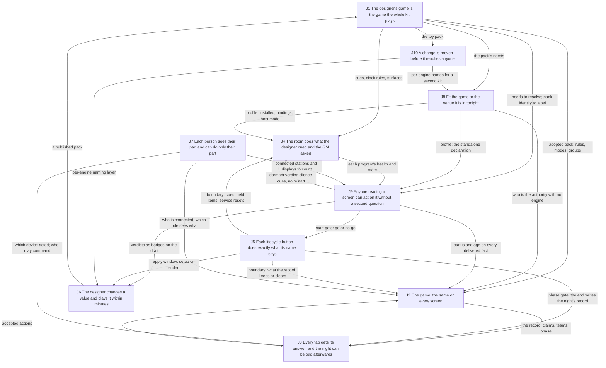

# How the ten jobs relate to each other, and each job said from the side of the people it serves

**Status: reader sheet for the architecture pass, step 1, relationships level. Nothing here is decided.** Every target shape below is a candidate for step 3. The owner asked two things of this sheet: say each job functionally (who, at what moment, what must happen), because some are described by their mechanics, J8 and J9 first; and work out how the ten jobs relate, at both levels (the big parts and the modules inside them), so that the architecture is designed for the whole engine and stays easy to keep building.

- **Date:** 2026-11-01. **Tree:** `/home/user/ALN-Ecosystem`, branch `claude/nice-curie-hescfv`. Nothing was run except `sed`, `grep` and `ls` to read records and re-check cited code lines. The stale clones beside the repository were not read. `backend/.env` was not opened.
- **Sources and citation keys.** EJ = `docs/plans/architecture-pass/2026-10-31-engine-jobs.md` (the ten jobs; `EJ:N` is line N; `EJ J4` is that job's entry; `EJ §4` is the open questions). JC = `2026-10-31-jobs-capabilities.md`. JF = `2026-10-31-jobs-flaws.md`. AN = `2026-10-30-cause-analysis.md` (flaws C1 to C16). SP = `2026-10-31-standalone-pass.md` (proposed flaw N1). MD = `2026-10-30-map-direction.md` (the 52 capabilities, numbered as EJ numbers them). RS = `2026-10-30-map-runtime-state.md` (section 0 read first). TC = `relationships/2026-11-01-today-components.md` (the big parts against the jobs; its sections 2, 5, 6 and 7). BM = `relationships/2026-11-01-today-backend-modules.md` (the 90 backend modules against the jobs; its sections 3 to 7). PD = `docs/plans/2026-10-30-architecture-pass.md` (the nine questions, PD:96-106). CS = `docs/plans/CURRENT-STATE.md` (decisions 22 and 26, questions 19 and 23 to 25, section 0). CTX = `CONTEXT.md`. All records are under `docs/plans/architecture-pass/` unless the path says otherwise. A code citation `path:line` was re-read in this tree today; one followed by "via KEY" was carried from that record.
- **Words.** The design words (module, interface, implementation, depth, deep, shallow, seam, adapter, leverage, locality) are exactly as `codebase-design` defines them, and are used only where a structural claim needs them. Authority, copy and delivery path are CTX section 4b (lines 383-407). Verdict is CTX section 2; dormant and paper/live are CTX section 5. "Game" is one played game. Standalone and networked are deployment modes (CTX section 1, "mode", meaning 2). In owner-facing text, "the engine" is the backend plus everything it drives, "the tablet" a GM scanner, "the phone" the web player scanner, "the hardware scanner" the ESP32.
- **People.** The five users the direction map names (MD:52-57): the designer, the venue installer, the GM, the player, the audience; and a sixth this sheet adds because the owner's frame names it (CS decision 26): the developer who keeps building the engine.

## 1. In short

1. **Two of the ten jobs are not jobs of the same kind as the other eight.** J9 (tell the truth) and J10 (stay trustworthy) are qualities that apply across the others: J9 has one mechanism of its own (a fact that carries how sure it is) and otherwise rides on J2's and J4's delivery; J10 has two (checking the joins, keeping engines apart) and otherwise grades every other job. J5 (the life of a game) is a third kind: a table of moments that every other job reads, as EJ already says (EJ:184). The seven others produce something another job consumes (section 5).
2. **Eleven mechanisms are shared by three or more jobs** (section 3). Four of them look like parts of their own at the component level and have no home today: delivering a labelled fact to a screen (used by six jobs), knowing who is connected and what they are (five), answering a request so the caller can tell what happened (five), and keeping two engines apart by name (three). Three exist and are the best-shaped modules in the tree: the pack's rules, the verdict function and the health registry (BM §7 item 1). One, the authority switch for a game with no engine, is not a module but a parameter every other mechanism must take (SP section 5, first bullet).
3. **The dependency graph has a spine and a ring.** The spine runs pack to record to answer: J1 feeds J2, J4 and J8; J2 and J5 feed J3; J7 feeds J2 and J3. The ring is J4, J8, J9 and J5: equipment, profile, verdict and boundary feed each other in a loop (section 5). Today that ring is also the one require cycle in the backend, seven modules wide, running through the record (BM §5.1).
4. **The owner's four open questions all turn on one distinction: a job versus a shared mechanism.** D (J3) splits by moment and person. E (J8) splits by kind: the installer's fitting is a job with an output; "with or without an engine" is a parameter, not a job. F (J10) splits by moment: the developer's green run is a quality over every job; release day is one moment with one person. G (equipment state on screens) is a mechanism neither J2 nor J4 should carry in its sentence; CTX section 4b already files equipment facts inside runtime state, which favours JC's reading if one job must hold the words (section 6).
5. **At the module level the spread is in the shared mechanisms, not in the jobs.** `commandExecutor` serves six jobs, `sessionService`, `broadcasts`, `cueEngineService`, `videoQueueService` and `transactionService` five each (BM §4), and all of them are the places where one of the eleven mechanisms is today implemented inline in a job's module instead of once.

## 2. The ten jobs, said from the side of the people they serve

Each entry: the restatement (under 60 words, counted by hand), then what the current wording gets wrong, if anything. J8 and J9 first, as the owner asked; then the others in order. The current wording is EJ section 2 (EJ:34-43).

### J8. Fit the game to the venue it is in tonight

**Restatement.** The installer, fitting an event, states what the kit brings tonight, binds the pack's names to real instruments, and gets one go or no-go. A GM running a game with no engine gets a game that knows it, not one mourning a lost connection. A second operator later stands up a kit without touching engine code. (56 words)

**What the current wording gets wrong.** "Run wherever the venue and the game need" (EJ:41) makes the engine the subject and names places: the show machine, the venue's equipment, other kits. The people are missing. Two different people hide in it: the installer, whose moment is the days before an event and whose act is fitting (MD:54 names this user; JC:241 notes no draft job names the act), and the GM running a standalone game, whose moment is the show. "Profile", "preflight", "host file" and "seams for more kits" are the mechanisms. What the installer needs is that one page and one button settle whether the room can run the show; what the standalone GM needs is that nothing on any device reads the absence of an engine as a fault (SP:19, SP-03, SP-20). The "other kits" clause is not a person's need tonight; it is the business rule that nothing may assume one kit (MD:57, MD:59), which is a constraint on every job, not a job.

### J9. Let anyone reading a screen act on it without a second question

**Restatement.** Anyone reading a screen can tell, without asking, whether what they see is current and whether they must act. The GM at a glance mid-show: red means act now, grey means absent on purpose, old looks old. The installer's go is a go. The audience's clock never counts on its own. (51 words)

**What the current wording gets wrong.** "Tell the truth about what it knows" (EJ:42) makes the engine the speaker and lists the four states a fact can be in (unknown, out of date, broken, not installed). Those states are the mechanism: a label a fact carries. The need is the reader's: a GM mid-show has seconds, and must decide from one glance whether to touch a panel (CTX:340-342, "red that is always red trains GMs to ignore red"). The installer's need is that the preflight's go means the room will run (CTX section 5, "Preflight"), and the audience's that the TV never shows a countdown the engine has not confirmed (AN C10, D-22). Said this way, J9 has one mechanism of its own, the labelled fact (status, age, paper or live), and otherwise depends on the delivery paths of J2 and J4 to carry that label; today no client reads the ages that exist (RS section 0, "Ages exist but no client reads them"). That is why section 5 draws J9 as a quality with edges into J2, J4, J5 and J6, not as a producer.

### J1. The designer's game is the game the whole kit plays

**Restatement.** The designer publishes a game and the whole kit plays that game, that version, with no code change: the engine scores by it, the TV shows its words, every tablet and scanner holds the same copy, and the GM can see at a glance that they match. A second designer's game runs on the same engine. (56 words)

**What the current wording gets wrong.** Little. "Every part of the kit runs the same version of the pack and says which" (EJ:34) is a mechanism (version reporting) where the need is the GM's: seeing at doors-open that the tablets, the TV and the engine agree, or being refused (EJ J1 test 2). The moment has two halves: between games, when the designer publishes, and doors open, when agreement must be visible.

### J2. One game, the same on every screen

**Restatement.** Mid-show, whatever the GM did on any tablet is what every tablet, the TV and the audience see, at once and after a tablet comes back: a delete frees the token everywhere, a reset empties every screen. Nobody has to ask which screen is right. In future games a player's hidden fact reaches only its owner. (56 words)

**What the current wording gets wrong.** "Decided in one place" (EJ:35) is a design answer (one authority per fact, CTX 4b), not the need. The need is agreement, and a GM's confidence that a second tablet is not lying. "Also after it reconnects" is right and functional. The sentence does not name the audience, who read the TV, or the future player with a hidden fact (MD:232), who is J2's reason for engine-side filtering.

### J3. Every tap gets its answer, and the night can be told afterwards

**Restatement.** When the GM taps a token or a button, or a player taps a token, they learn at once whether it counted, and why not if it didn't; nothing is silently lost or silently doubled. After the show, the owner and designer read the night's story from what was captured during play, not reconstructed. (54 words)

**What the current wording gets wrong.** "Remember what happened" (EJ:36) is the mechanism (a record). Said from the people's side the sentence has two different people at two different moments: the GM and the player at the tap, during play; the owner and the designer at the Review stage, after the end (MD:55, MD:228). The two halves also depend on different things (section 4, pairs J3-J5 and J3-J2) and have different flaws (JF:223). That bears on question D (section 6).

### J4. The room does what the designer cued and the GM asked

**Restatement.** The audience sees the video and hears the music the designer cued, when the game says so. The GM, from the Environment and Show Control sections, makes the room do a thing and sees it happen, or sees at once that it didn't and what to press. A dead program comes back by itself before anyone notices. (57 words)

**What the current wording gets wrong.** "Know its true state" (EJ:37) is J9's quality applied to equipment, and it is the half the two mapping sheets could not place (JF:225, JC:274; question G). The audience, the main beneficiary of J4, is absent from the sentence. "Drives them" is the mechanism; the need is that the room obeys and that the GM is never left guessing whether it did (AN C2, A-72: a panel that looks calm while the player is dead). The restart rule (MD:168-170) belongs here as "comes back by itself".

### J5. Each lifecycle button does exactly what its name says

**Restatement.** The GM starts, pauses, ends and resets games with confidence that each act does exactly what its name says: an ended game stays ended, the next game starts clean, a restart during a show loses nothing, a pause blocks scans. The designer's between-games edit lands in the next game, never the one in progress. (54 words)

**What the current wording gets wrong.** "Every fact has a defined fate at each of these moments" (EJ:38) is the developer's table, which EJ already says is J5's whole deliverable (EJ:184). From the GM's side the need is trust in the verbs: today an ended game returns after a restart (RS section 0; `backend/src/services/sessionService.js:108-110,532`), a once-only cue stays spent into the next game (AN C4, B-17), and a reset leaves the music panel dead (AN C5, B-01). The table is the right mechanism; the sentence should name whose trust it protects. The designer's edit belongs here as the moment at which a pack may change (MD:183).

### J6. The designer changes a value and plays it within minutes, and the live show never notices

**Restatement.** The designer, in the days before a show, changes one value, applies it and plays a round within minutes, on their laptop or the show machine between games, and nothing they do can reach the live show or its records. A new designer can learn the loop from the toy game without reading code. (54 words)

**What the current wording gets wrong.** Little; it is already written from the designer's side (EJ:39, EJ:219). "Publish a pack, apply a change, rehearse on a preview engine" are the mechanisms' names. "Without disturbing a live show" is the one clause that belongs to J10's mechanism (EJ:407).

### J7. Each person sees their part and can do only their part

**Restatement.** The GM alone can start, pause, end and change scores, and the engine knows which tablet did it. The audience sees scores and exposed evidence and nothing else. A player sees the memory they scanned, with no account. A stranger on the venue wifi sees nothing. A future game's secret reaches only the player it belongs to. (57 words)

**What the current wording gets wrong.** Little after the widening (EJ §4 question B). "The engine knows who is connected" (EJ:40) is the mechanism (a credential on every connection, MD:177); the needs it serves are attribution (which tablet did it; today a hardware scanner is filed as a phone, `backend/src/routes/healthRoutes.js:54`) and exclusion (today anyone on the kit network fetches the whole state, `backend/src/app.js:116`; `backend/src/websocket/socketServer.js:53` asks a credential only of a socket that calls itself `gm`).

### J10. A change is proven before it reaches anyone, and the owner alone sends it to the show

**Restatement.** The developer who changes the engine learns before the show, from a green run, that the show path still works for ALN and for the toy game. The owner decides when a new version goes to the venue and can swap back by replugging a machine. No test and no rehearsal ever reaches a live show. (56 words)

**What the current wording gets wrong.** "Tests prove the real show path, the parts that join are checked against each other, the installed pieces match, and testing never touches a live show" (EJ:43) lists four mechanisms and no person. Two people and two moments are inside it: the developer, before every change, who needs the green run to mean something (AN C16, C14, C8); and the owner, on release day, who needs the deployed pieces to match and a rollback that works (AN C15; CTX section 5, "Blue/green"). That bears on question F (section 6).

## 3. The shared mechanisms, each named once

A mechanism is shared when two or more jobs cannot be done without the same piece of behaviour. For each: the jobs that use it; where it lives today at the component level (TC) and the module level (BM); and whether it looks like a part of its own (one module with one interface that several jobs call, in `codebase-design` terms a deep module at a seam several jobs cross) or a job's internal piece (behaviour only one job needs, which other jobs merely trigger). "Part of its own" is a reading of today's shape, not a design.

| Id | Mechanism, in one line | Jobs that use it | Where it lives today (components; backend modules) | Part of its own, or a job's piece |
|---|---|---|---|---|
| M-A | **Applying the pack's rules**: what a mode means, what a scan is worth, when a group completes, whether a claim consumes, how money is written | J1 (owner), J2 (scores, claims), J3 (the reply's wording and verdict), J4 (cues, clock, surfaces, lighting roles), J8 (the pack's needs), J9 (needs into verdicts) | Backend `gameRules/*` and `packService` (deep, BM §2 rows 5-15, 51); the tablet's own copy in `ALNScanner/src/core/scoring.js`, `modeSemantics.js`, `storage/LocalStorage.js` (TC §2 finding 3; SP section 1: nothing under `ALNScanner/src` imports `backend/src/gameRules/`); the TV reads `game.json` itself (`backend/public/scoreboard.html:1231`) | **Part of its own, already.** Two implementations at one seam (engine and tablet) make the seam real (TC §6.3), but no shared interface or code joins them, only one end-to-end test that skips its group case on the real pack (TC §7, last row) |
| M-B | **Delivering a fact to a screen**: one route per fact, the same for the live change and the catch-up after a reconnect, carrying the fact's label (M-F's words, M-G's finality) | J2 (game facts), J4 (equipment state), J9 (the label on each), J1 (pack identity in the snapshot), J7 (filtered by role), J5 (the boundary itself as a message to every screen) | Backend `websocket/broadcasts.js` (41 listener sites) and `syncHelpers.buildSyncFullPayload` (two builders per fact, `backend/src/websocket/broadcasts.js:183`, `syncHelpers.js:36`; BM §3 J2); the tablet's four routers and four write rules (TC §3.2 J2); the TV's own rules (TC §3.6); health on a different route from state (RS section 8 Q2) | **Part of its own.** Six jobs cross it; deleting it puts a route back into each of them (the deletion test). Today it is implemented inline in J2's and J4's modules twice over, which is where C2, C6 and the equipment half of G sit |
| M-C | **Knowing who is connected and what they are**: a verified pass on every connection, the device's class and name, and whether it is still there | J7 (owner), J2 (which screens may see which record), J3 (which device acted), J8 (stations and remote displays the preflight counts, CTX section 5 "Remote display"), J9 (reachability, `device:disconnected`) | Backend `middleware/auth.js`, `gameRules/grants.js`, `websocket/socketServer.js`, `gmAuth.js`, `routes/healthRoutes.js` (registers a device on a read, line 54), `heartbeatMonitorService`, `deviceTracking` (BM §3 J7: "who may read what has no home"); five separate reachability answers across the clients (RS R54 via TC §4.9) | **Part of its own.** Mint and grants are deep already; the registry of who is connected is spread over six backend modules and every client decides its own reachability word |
| M-D | **Handling a game boundary**: at setup, start, pause, end, reset, restart, the next game and a pack change, what each fact and each copy keeps, clears or carries | J5 (owner; EJ says J5 *is* this table, EJ:184), J2 (claims cleared, scores reset), J3 (queues, history, the batch cache), J4 (once-only cues, held items, service reset), J1 (the pack adopted per game), J6 (apply allowed only in setup or after an end), J9 (verdicts recomputed) | Backend boot `app.js:178-352`, Reset System `systemReset.js:122-162`, `sessionService` lifecycle methods, thirteen `reset()` methods (BM §3 J5); the tablet infers a boundary from a session id change (`ALNScanner/src/network/networkedSession.js:246-259`); the TV the same (TC §3.6); the phone's seen set and the hardware scanner's queue outlive every game (RS R59, R12) | **J5's own piece, and J5's whole content.** The question for step 3 is whether it becomes a module: a lifecycle module that owns the moves and is the only caller of every `reset()` and cascade (BM §7 item 3) |
| M-E | **Reading and keeping alive an outside program**: one adapter per program, one supervision rule, the engine's picture of it dated | J4 (owner), J9 (the health word and its age), J8 (host mode self or adopt, MD:171-172; kit names), J10 (process files that cannot hit the wrong process, MD:173) | Seven adapters, one each, no interface above them (BM §6); `utils/processMonitor` supervises five, three spawn their own (BM §3 J4); `musicService.connected` beside the registry (`backend/src/services/musicService.js:73`); the TV's browser is both a program the engine runs and a client of it (TC §6.1 split 11) | **J4's internal piece**, with one slice that belongs to M-H (the per-engine names of process files) and one to M-F (the health word). Step 3's question is whether the first declared interface describes the program or the capability (BM §7 item 4) |
| M-F | **The verdict**: what the game needs against what the kit has tonight, one pure function, each line labelled paper or live, three health words | J9 (owner), J8 (the installer's preflight), J6 (the editor's badges on the draft), J4 (dormancy silences cues and stops restarts), J5 (recomputed at create, reset, restore) | Backend `gameRules/packNeeds`, `resolution`, `endpointServices`, `preflightService`, `dormancyService`, `serviceHealthRegistry` (deep; BM §2 rows 9, 13, 14, 53, 56; `backend/src/gameRules/resolution.js:31`, `preflightService.js:83`); the result reaches no screen except a session stamp and ack text (RS R50 via TC §2 finding 9) | **Part of its own, already built.** CTX section 2 ("One truth, three loops") designed it as one; the missing half is M-B carrying its output to the screens that need it |
| M-G | **Answering a request**: a reply that says which request it answers, whether it is final, and whether anything was stored | J3 (owner), J2 (the claim and score the reply carries), J4 (a `gm:command` acknowledgement; a held cue as an answer the GM sees), J5 (the reset's acknowledgement), J7 (a refusal by role) | Three reply shapes at three entrances (BM §3 J3: `scanRoutes` inline JSON, `adminEvents` `transaction:result` or `error`, `commandExecutor` `{success, message}`); the tablet matches acknowledgements by action name only (`ALNScanner/src/admin/utils/CommandSender.js:43`); the phone and the hardware scanner classify the same HTTP status differently (TC §6.1 split 3) | **Part of its own.** A small deep module (one envelope, one set of outcome words) used by five jobs; today its absence is C7 |
| M-H | **Keeping engines apart**: every name an engine owns (process files, sockets, ports, data folder, passes, the display it drives) is per engine | J10 (owner; tests beside a live show), J6 (a preview engine beside the live one), J8 (a second kit; no kit-unique name in engine code, MD:59) | Nothing. Sixteen fixed `/tmp` literals in eight files, two machine-wide kills, media folders under `public/` (BM §5.9; `backend/src/utils/displayDriver.js:53,147`); the tests adopt the live display and audio (RS section 7 via TC §3.10) | **Part of its own, not built.** EJ §4 already names it once under J10 with J6 pointing to it (EJ:407); J8's second-kit clause is the third user |
| M-I | **Publishing the pack to every holder**: one list of every copy, one way to fetch it, one notice that it changed, every copy showing which version it holds | J1 (owner), J6 (publish, then apply), J5 (apply only at a boundary), J2 (the pack identity in the snapshot), J9 (a stale copy shows as stale) | Nine holders, no message (TC §6.1 split 1); `packRoutes`, the tablet's `packLoader`, the hardware scanner's asset sync, the TV's two fetches, the config tool's child-process check (`config-tool/server.js:47`); `grep "pack:changed"` finds no event (BM §3 J1) | **Part of its own.** M-A is what the rules say; M-I is how the copy travels. Today the engine has the first and not the second (BM §7 item 7) |
| M-J | **Checking the joins**: every name and shape two parts share is checked against both, fakes against real classes, the same suite on two packs | J10 (owner), J1 (the two-pack run), J2 (the snapshot's shape against the live shape), J3 (reply shapes against the contract), J8 (the hardware scanner's token file against the pack's) | Three contract tests and the schema tests (TC §7); not joined: the hardware scanner's file shape, a fake against its class, the scoreboard's reading of the snapshot, the media folders against the pack (TC §7, last paragraph) | **Part of its own at the test level**, with one principle (a shape is written once and both sides read it) that M-B and M-G would make unnecessary for the shapes they carry |
| M-K | **The authority switch**: who decides each fact when there is no engine, and the declared fact that says a game is standalone | J8 (declares it), J2 (the tablet becomes the record), J3 (the tablet's store answers), J5 (the tablet decides every boundary), J9 (standalone by choice draws differently from engine down), J1 (where the declaration might live) | A tap (`ALNScanner/src/app/sessionModeManager.js:30-40`), a URL path (`aln-memory-scanner/js/orchestratorIntegration.js:33-34`), nothing on the hardware scanner, no pack field (SP:19; N1) | **Not a part; a parameter.** Every rule must name its authority with the engine absent (SP section 5, first bullet). Where the fact is held is the owner's step-3 question (CS section 0; SP:251) |

Two observations on the table, in design words.

- **The mechanisms, not the jobs, are where today's modules are stretched across many jobs.** The six backend modules that serve five or six jobs (`commandExecutor`, `sessionService`, `broadcasts`, `cueEngineService`, `videoQueueService`, `transactionService`; BM §4) each hold one of M-B, M-D or M-G inline. `commandExecutor` is M-G's `gm:command` half plus M-C's floor plus M-F's health gate, and it is shallow, a dispatch table whose interface is the union of what it forwards to (BM §2 row 35). `broadcasts.js` is M-B for thirteen services and also does equipment coordination that is J4's own (BM §5.5). Giving each mechanism a module of its own would give these six locality: a change to how a fact reaches a screen would land in one place instead of in a listener list, a snapshot builder and three tablet routers.
- **The pure modules already are the shared mechanisms done right.** `gameRules/*` (M-A), `resolution` and `packNeeds` (M-F) and `serviceHealthRegistry` (M-F's health half) are deep, pass the deletion test and are the easiest to test (BM §7 item 1). They are the pattern the other mechanisms could follow: a small interface, the rules behind it, I/O outside.

## 4. Every pair of jobs, with a verdict

Verdict words: **D** = one needs the other's output (the arrow gives the direction, from producer to consumer; two arrows mean both ways); **S** = they share a mechanism (named by M-id); **Q** = one is a quality that applies across the other; **thin** = a relation exists but carries little; **none** = no direct relation found. A pair can carry more than one verdict. Evidence names a record or a code line.

| Pair | Verdict | Direction, mechanism, or quality | Evidence |
|---|---|---|---|
| J1-J2 | D, S | J1 → J2: the adopted pack's rules decide every score and claim. S: M-A, M-I (pack identity rides the snapshot), M-B | `backend/src/services/transactionService.js` requires `gameRules/scoring`, `duplicatePolicy`, `modeSemantics` (BM §2 row 63); `syncHelpers.js:151` |
| J1-J3 | D, S | J1 → J3: the mode's meaning and the money format shape the reply. S: M-A, M-G | `websocket/scanResponse.js` requires `gameRules/formatting` and `packService` (BM §2 row 88) |
| J1-J4 | D, S | J1 → J4: cues, clock rules, surfaces, lighting roles come from the pack. S: M-A | `cueEngineService.loadCues`, `gameClockService.setPhases`, `packService.getSurfaces` (BM §2 rows 38, 43, 51); TC §3.9 J4 |
| J1-J5 | D both ways, S | J5 → J1: the pack is adopted per game and may change only at a boundary. J1 → J5: the clock and phase rules each game runs by. S: M-D, M-I | MD:183 (refused while active or paused); clock rules fetched at five sites (BM §3 J1) |
| J1-J6 | D, S | J6 → J1: the designer's publish is the pack the engine adopts. S: M-I (publish store into channel), M-F (badges on the draft) | `config-tool/lib/publish.js:100`; TC §3.8 J6; MD:192-193 |
| J1-J7 | thin, S | Only the pack hash rides the handshake pass. S: M-C (that one field) | `ALNScanner/src/network/orchestratorClient.js:101`; `socketServer.js:139` logs a mismatch and does nothing |
| J1-J8 | D, S | J1 → J8: the pack's needs are what the installer fits the room to; the rider is derived from them. S: M-F, M-K (the pack is one candidate home for the standalone fact) | `gameRules/packNeeds` (BM §2 row 13); MD:205; SP:251 question 4 |
| J1-J9 | D, Q, S | J1 → J9: the needs feed the verdict; the pack's identity is a fact the screen must label fresh or stale. Q: J9 over J1 (a different pack must show). S: M-F, M-I | EJ J1 test 2; TC §6.1 split 1 (the tablet ignores the snapshot's `pack` key) |
| J1-J10 | D, S | J1 → J10: the toy pack is the proof the engine is generic. S: M-J (two-pack run, schema tests, drift tripwires) | CTX section 2 ("Toy pack", "Dual-pack Tier L"); TC §7 |
| J2-J3 | D both ways, S | J2 → J3: the record is what a scan is answered against (claimed? which team? which phase). J3 → J2: accepted actions are what the record is made of. S: M-G, M-B | `gameRules/duplicatePolicy.checkDuplicate` takes the session's transactions (BM §2 row 8); `transaction:accepted` is persisted by `sessionService` (BM §3 J3) |
| J2-J4 | S | Game facts and equipment facts travel the same path to the same screens, by two routes today. No output dependency except through J3 (is a video playing gates a player's video) | M-B; RS section 8 Q2; CTX section 4b lists the video queue, music, held items and health inside runtime state (the "Runtime state" entry, CTX:388 onward). This is question G |
| J2-J5 | D, S | J5 → J2: each boundary says what the record keeps or clears (claims after a reset, the ended game after a restart). S: M-D | AN C1 (reset while disconnected), C4 (ended game returns); `sessionService.js:108-110` |
| J2-J6 | thin D, S | J6 → J2, through J1: a hot-apply must tell every client the pack changed. S: M-I | MD:184; JC:116 |
| J2-J7 | D, S | J7 → J2: who is connected decides which screens receive the record and how much of it (filtering for hidden facts). S: M-C, M-B | MD:232 ("filtering on the screen is fatal"); `gmAuth.js:61` builds the same payload for operators and displays (BM §3 J7) |
| J2-J8 | D, S | J8 → J2: in a game declared standalone the tablet is the record's authority. S: M-K | MD:64 (authority split); SP section 1; `LocalStorage.js:31-37` via TC §3.3 |
| J2-J9 | Q, S | Q: J9 over J2 (J2 makes the screen right, J9 makes it say so when it cannot be). S: M-B carries the label | EJ:406 (the written boundary); RS section 0 (ages unread) |
| J2-J10 | S, Q | S: M-J (the catch-up shape against the live shape). Q: J10 over J2 (the join tested, not kept by hand) | EJ J2 test 3 (B-30); AN C6 |
| J3-J4 | D both ways, S | J4 → J3: whether a video is playing decides the player's reply; a held cue is an answer the GM sees. J3 → J4: a GM command is answered by J3's envelope and carried out by J4. S: M-G (`gm:command:ack`) | `transactionService.js:517` asks `videoQueueService` (BM §2 row 63); MD:162 (held items); `commandExecutor.js:38` (`SERVICE_DEPENDENCIES`) |
| J3-J5 | D, S | J5 → J3: the game's phase gates whether a scan counts; the end is when the night's record is written; a restart must not double a batch. S: M-D | `scanRoutes.js:43` (any session), `transactionService.js:157` via MD:40 (active only); MD:225-226; `scanRoutes.js:183` (the batch cache, lost at restart) |
| J3-J6 | thin | A rehearsal is only as good as the answers the preview engine gives; no mechanism or output passes between them directly | MD:199 (a GM-scored trial needs a started game) |
| J3-J7 | D, S | J7 → J3: which device acted, and whether it may; a refusal by role is an answer. S: M-C, M-G | `healthRoutes.js:54` (hardware scanner recorded as `player`); `commandExecutor.js:152-155` (the floor) |
| J3-J8 | D, S | J8 → J3: with no engine the tablet's store is the answerer; the phone and the hardware scanner classify replies by their own rules. S: M-K, M-G | SP section 2 C7 and C9; `LocalStorage.js:302` via TC §3.3; `ScanResponse.h:51-75` via TC §3.5 |
| J3-J9 | Q, S | Q: J9 over J3 (an answer that cannot say final or stored is not an honest answer). S: M-G carries finality the way M-B carries age | AN C7 (B-22: "processed" with nothing kept) |
| J3-J10 | S, Q | S: M-J (reply shapes against the contract). Q: J10 over J3 | TC §7 rows 1 and 2 |
| J4-J5 | D both ways, S | J5 → J4: a boundary resets services, suspends cues, decides held items' fate. J4 → J5: each service's `reset()` is what a reset is made of. S: M-D | `systemReset.js:122` (thirteen resets in order); CTX:328-337 (held items' expiry); AN C5 |
| J4-J6 | S | A preview engine replaces each outside program with a software stand-in, which is a second adapter at M-E's seam; and must not kill the live engine's programs (M-H) | MD:197 (simulation profile); AN C8 (D-72) |
| J4-J7 | D, S | J7 → J4: show control is operator-only; a cue may fire only cue actions. S: M-C (the floor), M-G | MD:67 (the floor); `commandExecutor.js:152-155`; `gameRules/cueValidation` (BM §2 row 5, the cue-source floor) |
| J4-J8 | D, S | J8 → J4: the profile says what is installed and binds roles to instruments; the host file says whether to start or adopt a program. S: M-E (kit names), M-F | `profileService.getLightingBinding` (BM §2 row 54); MD:171-172; BM §3 J8 (kit names in twelve files) |
| J4-J9 | D both ways, Q, S | J4 → J9: each program's health and state. J9 → J4: a dormant verdict silences cues and stops restarts. Q: J9 over J4. S: M-B, M-E, M-F | `serviceHealthRegistry.js:32` (nine ids); `dormancyService.js:171`; CTX:338-349 ("Dormant vs fault"). This is question G |
| J4-J10 | S | S: M-H (process files and the display per engine; a test adopts the live player today), M-E (process cleanup that cannot hit the wrong process) | AN C8 (A-75: a unit test killed the live player); MD:173 |
| J5-J6 | D, S | J5 → J6: apply works only in setup or after an end; the preview engine runs its own game's life. S: M-D | MD:183, MD:199 |
| J5-J7 | D, S | J7 → J5: start, pause, end and reset are operator-only; passes die at an engine restart. S: M-C | MD:67; `middleware/auth.js:92-96` via BM §2 row 16 |
| J5-J8 | D, S | J8 → J5: with no engine the tablet decides every boundary; a profile change ends in a restart, not a reload. S: M-K | SP section 2 C4 (SG-01); MD:206 |
| J5-J9 | D both ways, S | J5 → J9: verdicts recomputed at create, reset and restore; the display row must not stay red after a reset. J9 → J5: the start gate refuses on a no-go. S: M-F, M-D | MD:160-163; `sessionService.startGame` runs preflight (BM §3 J5) |
| J5-J10 | S, Q | S: M-D must be one code path in tests and in production; today the listener registry removes listeners only under test. Q: J10 over J5 | `backend/src/websocket/listenerRegistry.js:13,44-48`; AN C16 (X-04); MD:255 |
| J6-J7 | D, S | J7 → J6: the designer's tool has its own login; a preview engine must mint passes the live engine refuses. S: M-C | TC §3.8 J7 (a second login against the same password file); MD:198 |
| J6-J8 | D, S | J8 → J6: a preview profile makes hardware-shaped needs read dormant on a laptop; where the preview engine runs is undecided. S: M-F, M-H | MD:197, MD:40-41 (the gap) |
| J6-J9 | D, S | J9 → J6: the editor's badges are the verdict function run on the draft, labelled paper or live. S: M-F | MD:193; JC:154 |
| J6-J10 | S, Q | S: M-H, one naming layer for a preview engine and a test run. Q: J10 over J6 (rehearsing is a kind of testing) | EJ:407; MD:256 |
| J7-J8 | D both ways, S | J7 → J8: stations and remote displays are counted against the profile. J8 → J7: a standalone game has no connection and no credential. S: M-C, M-K | CTX section 5 ("Remote display"); SP section 2 C13 |
| J7-J9 | D, S | J7 → J9: knowing who is connected is what reachability and `device:disconnected` rest on. S: M-C | `heartbeatMonitorService` (BM §2 row 44); RS R54 via TC §4.9 (five reachability answers) |
| J7-J10 | Q, thin | Q: J10 over J7 (secrets rotate before outsiders; the credential rules are tested). No shared mechanism | MD:70; TC §7 row 4 |
| J8-J9 | D, S | J8 → J9: the profile is the "has" side of every verdict; a declared standalone game lets each device say "standalone" rather than "offline". S: M-F, M-K | `gameRules/resolution.js:31` (`resolve(needs, profile, inventory)`); SP:99 (the dormancy idea) |
| J8-J10 | D, S | J10 → J8: the per-engine naming layer is what makes a second kit or engine possible; release day's "installed pieces match" is between them. S: M-H | MD:59, MD:244; AN C15 (A-91, a rollback that moves no submodule) |
| J9-J10 | Q, S | Q: J10 over J9 (screen baselines and the truth sweep prove screens tell the truth). S: M-J | MD:107, MD:212; CTX section 7 ("Truth sweep") |

Counts from the table (by `grep` over the verdict column): 45 pairs; 32 carry a dependency (D), 43 share at least one mechanism (S), 10 carry a quality (Q), 4 are thin, 0 are none. The two jobs with no D as a producer are J9 and J10 in their quality role, except J9 → J4, J9 → J5 and J9 → J6, where the verdict is an output other jobs consume.

## 5. The dependencies, drawn

Twenty-five edges, chosen from the D rows of section 4 by weight (the ones whose absence breaks the consuming job tonight). A label names the output that crosses. The ring J4, J8, J9, J5 and the spine J1, J2, J3 are visible; J7 enters the spine from the side; J6 and J10 sit off the show.

What the drawing shows for the design.

- **The spine is where a networked show lives at the moment of a tap:** J1 to J2 to J3 and back, with J7 saying who tapped. Today these three are each split across up to six parts (TC §2 finding 1): the tablet decides first (`ALNScanner/src/app/domains/gameOps.js:329-331,376`), the phone and the hardware scanner decide whether a token exists, the TV decides the evidence rule (`scoreboard.html:1231`). The spine's mechanisms are M-A, M-B, M-G and M-C.
- **The ring is where the engine's own machinery lives:** J4 reads the room, J8 says what the room has, J9 turns both into a verdict, J5 says when to recompute and what to reset, and the verdict feeds back into J4. Today the ring is also the backend's one require cycle, `sessionService`, `persistenceListeners`, `transactionService`, `videoQueueService`, `cueEngineService`, `commandExecutor`, `dormancyService` (BM §5.1), which is the ring drawn in code with the spine's record (`sessionService`) caught inside it. BM §7 item 3's candidate, a lifecycle module as the only caller of every cascade, is M-D given a module.
- **J6 and J10 touch the show only through J1 and the naming layer.** That is the shape the roadmap wants (a designer's week never disturbs a show night, EJ:219) and the shape today lacks: the config tool reaches the engine by file and import (TC §2 finding 6), and the tests reach the live machine (TC §3.10).
- **J9 has edges in both directions and J10 has only edges out,** which is the drawn form of finding 1 in section 1: J9 produces one thing (the verdict) and otherwise labels what others deliver; J10 produces one thing (the naming layer) and otherwise grades.

## 6. What the relationships say about the owner's open questions D to G

Each answer is what the pairs table and the mechanisms show. None decides; each names the candidate the evidence favours and what the other choice would cost.

**D. Split J3 into answering and remembering?** The relationships favour two jobs, or one job with the second half filed elsewhere. The two halves have different people and moments (section 2, J3): the GM and the player at the tap, the owner and the designer after the end. They have different mechanisms: answering is M-G (the envelope), shared with J2, J4, J5 and J7, and the dense part of J3's row in section 4; remembering is M-D's end moment (the bundle is written when the game ends, MD:225-226) plus a capture path from the tablet to the record before the end (MD:226), and its reader is J6's Review stage (MD:228). They depend on different things: answering needs J2's record, J5's phase gate and J7's identity now; remembering needs only that the end moment exists and the record is whole. The cost the flaws sheet names stands (no flaw would have the new job as primary, JF:223); the relationships add that the new job would have exactly one incoming edge (from J5's end) and one outgoing (to J6's Review), which is the signature of a job of its own with a small interface, not of a half of J3. The alternative the relationships also support: keep J3 as "answer every action" and treat the night's record as a row in J5's table (what the end moment writes) with the Review stage under J6. Either way the two halves should not share one sentence, because a reader looking for the tap's answer and a reader looking for the report are different people.

**E. Split J8, or rename it?** The relationships show J8 is two different kinds of thing, and only one is a job. The installer's fitting produces an output, the profile, consumed by J4 (bindings, host mode) and J9 (the "has" side of every verdict), and it consumes J1's needs: three edges in the drawing, a real node. "With or without an engine" and "on other kits later" produce nothing. The first is M-K, the authority switch, a parameter that changes who decides in J2, J3, J5 and J9 (SP section 5, first bullet: every rule names its authority with the engine absent); the second is M-H, the naming layer, which J10 owns and J6 shares. So the relationships favour: J8 as "Fit the game to the venue" (the installer's job, JC:271's first half), with the standalone declaration kept as a clause J8 declares and every other job's rule takes as input, and "other kits" as J10's naming layer and the business constraint on every job (MD:59). A J11 "run in any setup" (JC:271) would be a job with no output of its own, which is the shape of a quality or a parameter, not a job; the cost of not creating it is that the second audience (a standalone GM, a future operator) is named only in J8's clause and J10's mechanism. The rename JC offers, "Fit the game to the venue, whatever the setup", carries both.

**F. J10: widen, split, or leave?** The relationships split J10 by moment and person, not by kind of work. Before every change, the developer's green run: tests real (C16), joins checked (C14, M-J), engines kept apart (C8, M-H). This half is a quality over every job (the ten Q rows in section 4 are J10's or J9's) with one mechanism of its own (M-H) and one shared with J1 (M-J, the two-pack run). On release day, the owner's cutover: the installed pieces match (C15) and rollback is a replug (CTX section 5, "Blue/green"). This half is a job with one person and one moment, and its only relationships are with J8 (the deploy chain, cap 22, filed under J8 loosely at JC:45; the naming layer that a second machine needs) and J1 (the pack and media the deployed machine must carry). So widening the sentence (JC:272) is consistent with the graph, because release day touches only J8 and J1, and so is splitting (JF:231). The relationships add a third reading: release day belongs with the installer's Deploy chain (the handoff from designer to installer to GM that ends in a system ready to run, MD:205), which would put C15 under J8's fitting job and leave J10 purely a quality. Also for the owner: C15 and C16 are covered by none of the nine questions (AN:47, AN:49); the relationships place C15 at the J8-J10 pair and C16 at J10's quality role over J2, J3, J5 and J9.

**G. Who owns the equipment's state on screens, J2 or J4?** The relationships say: neither sentence should carry the route. "State onto screens" is M-B, one mechanism used by J2 (game facts), J4 (equipment facts), J9 (the label on both), J1, J7 and J5 (section 3). The flaws in the gap, C2 and the equipment half of C6, are M-B flaws: equipment state and its health take different routes from each other and from the game record (RS section 8 Q2), and the catch-up snapshot is built apart from the live event for seven facts (RS section 4.2 via TC §6.1 split 2). Put the words in J4 (JF:225) and J4's sentence then carries a route that J2 also needs; put them in J2 (JC:274) and J2's sentence carries equipment, which reads oddly against "the game's record". The candidate the relationships favour: J2 stays the game's facts agreeing on every screen, J4 stays what the room must do for the GM and the audience, J9 stays how sure a screen says it is, and M-B is designed once in step 3 as a part of its own (one builder per fact, used for the live change and the catch-up, carrying the label; BM §7 item 5). If the owner wants one job to hold the words anyway, the vocabulary decides it for J2: CTX section 4b lists the video queue, the music, held items, the game clock, running cues and each service's health inside "runtime state" (the "Runtime state" entry, CTX:388 onward), so equipment facts are already copies of an authority delivered to screens in J2's own terms, which is JC's reading (JC:274).

## 7. Completion check

- **Ten functional restatements** in section 2, each under 60 words (counted with `awk '{print NF}'` over the restatement lines: J8 56, J9 51, J1 56, J2 56, J3 54, J4 57, J5 54, J6 54, J7 57, J10 56), each naming who relies on it and at what moment, each followed by what the current wording gets wrong. J8 and J9 first, as asked.
- **Forty-five pairs** in section 4, one row each (J1-J2 through J9-J10; 9+8+7+6+5+4+3+2+1 = 45), each with a verdict from D, S, Q, thin or none, a direction where D, a mechanism id where S, and a citation.
- **Eleven shared mechanisms** in section 3, M-A to M-K, each named once, each listing the jobs that use it (three or more), where it lives today at the component and module level, and whether it looks like a part of its own or a job's internal piece.
- **One Mermaid flowchart** in section 5: first line `flowchart TD`, ten nodes with labels in double quotes, 25 edges in the form `A -->|"label"| B`.
- **Questions D to G** each answered in section 6 from the relationships, with the candidate the evidence favours and what the other choice costs.
- **Not done.** No test, build, server or device was run. The 60-word counts are `awk` field counts, so a hyphenated pair counts as one word. The depth words are the sibling sheets' judgements (BM §0) and mine. Line numbers marked "via" were carried from the named record and not re-read; those written bare were re-read today with `sed`. The verdicts in section 4 and the placements in sections 3 and 5 are mine, drawn from EJ's job definitions and the two sibling sheets; the owner may redraw any pair.
- **Files written:** this document only.
