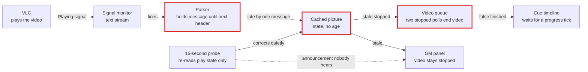
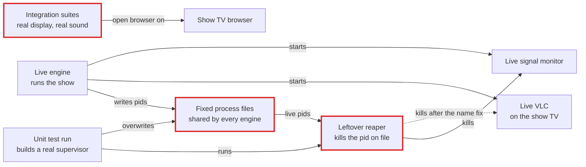
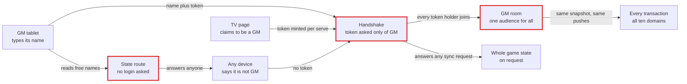
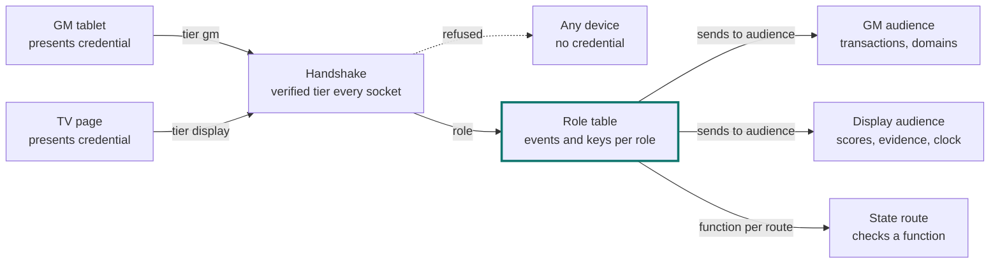
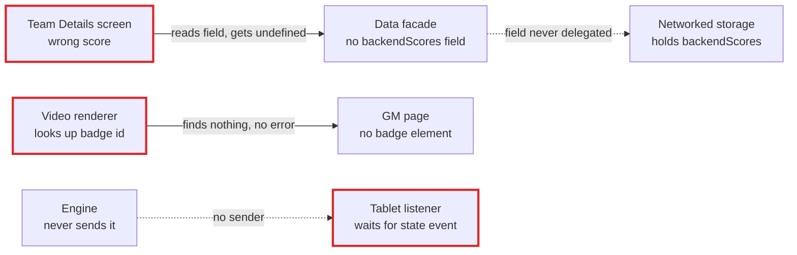
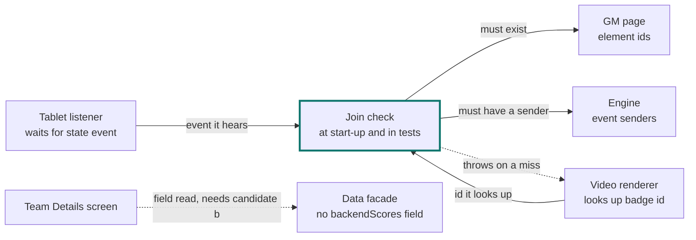
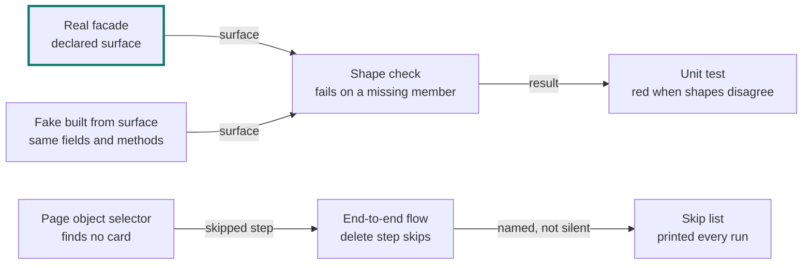

# Card check 2: C2, C3, C8, C11, C13, C14, C15, C16

- **Date:** 2026-10-31. **Tree:** `/home/user/ALN-Ecosystem`, branch `claude/nice-curie-hescfv`, ALNScanner at `e83723c`. Code citations are to the checkout as read today (code as of `12baf920` plus green's follow-ups at `089dd527`); analysis citations are `docs/plans/architecture-pass/2026-10-30-cause-analysis.md` line numbers.
- **Checked:** `report/2026-10-31-cards-g3.json` (C2, C3, C8, C11) and `report/2026-10-31-cards-g4.json` (C13, C14, C15, C16), refute by default: a claim holds only when it was confirmed against the analysis and the code.
- **How the diagrams were checked.** A rule lint (first line, letters-and-digits ids, quoted labels with no `"`, `;` or `#`, `<br/>` breaks only, at most 5 words a line and 2 lines, at most 8 nodes, exact `classDef` lines, one `owner` in each `after`), and a parse of all 16 diagrams in this share (corrected ones substituted) with Mermaid 11 in Chromium: 16 parse, 0 fail. Word limits were counted for every field, corrected ones included.
- **Result:** 48 claims, 30 hold and 18 are corrected. A corrected field is given below its table in full, ready to paste into the card JSON. Where a field needs no change, the card's text stands.

## C2. Service health and service state travel on separate paths

| Claim | Verdict | Evidence |
|---|---|---|
| 1. atAShow and whyItHappens say only what the analysis says | holds | Every sentence is in docs/plans/architecture-pass/2026-10-30-cause-analysis.md:21 (outage at start, progress bar after MPD dies) and §4.1 row :881 ("the health row goes red alone", the card keeps its "playing" look); the volume sentence is A-17 at :115, which the analysis limits to the audio panel's per-stream slider, as the card does. |
| 2. before diagram shows the cited code's mechanism | holds | `backend/src/services/musicService.js:609-618` (MPD `exited` handler) calls `_setConnected(false)` → `:230-233` reports to the registry only; `backend/src/services/serviceHealthRegistry.js:97-105` emits `health:changed` on a status change; `backend/src/websocket/broadcasts.js:536-538` pushes only the `health` domain for it; the music push list is `:505` (playback, volume, track, position, playlist events), lighting `:556`, audio `:549`: no health or outage event on any list. The dotted "no music event" path is what the code does. |
| 3. after is a listed candidate, marked, competing one named | holds | Candidate (a) at docs/plans/architecture-pass/2026-10-30-cause-analysis.md:127 (one record carrying health and state, pushed whole when either changes); the note names (b) :128 and (c) :129. Owner marked: the music service's record. |
| 4. designTerms uses the vocabulary and names the owner | holds | Names the service module as owner of one record; locates the leak at the broadcast module's per-domain event lists (`broadcasts.js:495-570`, the A-102 row). "Interface" is used in the skill's sense (everything a caller must know, here the full event list). Within 45 words. |
| 5. examples, findings, blueFixes, questions (and seenLive) match | corrected | Example ids A-11, A-12, B-33, C-43, A-17, A-102 all map to C2 in §5.1-5.3; findings 6 (§5.6); W4, W6 and questions 2, 9 match docs/plans/architecture-pass/2026-10-30-cause-analysis.md:21 and :133. `seenLive` fails in its second half: "blue's review recorded the frozen lighting panel" is not a sighting on running software. Blue's sheet marks A-11 live proof "yes", which it defines as "only code reading backs the row" (`2026-10-30-causes-blue.md:22`, row `:41`), and docs/plans/architecture-pass/2026-10-30-cause-analysis.md:135 lists A-11 for the rig. The music half stands: the owner reported it on blue's line (`docs/plans/2026-10-30-production-fixes-triage.md:108-112`; docs/plans/architecture-pass/2026-10-30-cause-analysis.md:114 "the owner's 'panel does not keep up with live music'"). |
| 6. Mermaid follows the rules | holds | Both sources pass the rule lint (first line, ids, quoted labels, at most 5 words a line and 2 lines, at most 8 nodes, classDef lines exact) and parse with Mermaid 11 in Chromium (`check_mermaid.js`: 16 of 16 diagrams in this share parse, corrected ones included). |

Corrected for claim 5: `seenLive`.

```seenLive
The owner reports the GM panel falling behind live music on blue's line until a refresh.
```

## C3. Engine trusts its stale picture of outside programs

| Claim | Verdict | Evidence |
|---|---|---|
| 1. atAShow and whyItHappens say only what the analysis says | holds | Sentences come from docs/plans/architecture-pass/2026-10-30-cause-analysis.md:23 (28-second stall, two-second false finish, MPD "playing" until the 15-second sweep, the 2-second cue) and the A-61 row :150 ("display mode flips back, ducking restores"). The why paragraph paraphrases the statement at :143. |
| 2. before diagram shows the cited code's mechanism | corrected | Most of the diagram matches the code: `backend/src/utils/dbusSignalParser.js:39-56` emits only at the next boundary and `flush()` (`:58`) has no caller; `backend/src/services/vlcMprisService.js:248-250` `getStatus()` returns the cached `this.state`; `backend/src/services/videoQueueService.js:358-371` completes after two non-playing polls. The probe edge is wrong. The card draws `probe -.->\|fix announced, nobody hears\| pic`, a correction that never reaches the picture. In the code, `backend/src/services/mprisPlayerBase.js:158-171` (called from `serviceHealthRegistry.js:236-244`) sets `this.state = newState` and the picture IS corrected. What goes unheard is the announcement: it emits `playback:changed` (`:170`), and the video push and the queue's wait listen only for `state:changed` (`broadcasts.js:512`, `videoQueueService.js:329`; X-01 at the analysis :155). The fix: the correction is a solid edge into the picture, and a dotted edge to the panel carries the announcement nobody hears. |
| 3. after is a listed candidate, marked, competing one named | holds | Candidate (a) at docs/plans/architecture-pass/2026-10-30-cause-analysis.md:178 (one reader per program, common interface, a periodic re-read the stream cannot switch off, last-read time). The note names (b) :179, (c) :180, (d) :181. Owner: the reader. |
| 4. designTerms uses the vocabulary and names the owner | corrected | The claim that "the parser, the player service and the queue are shallow: each exposes raw stream handling" is wrong for the queue. `videoQueueService.js:353-401` never touches a stream: it polls the cached state through `getStatus()`. The leak is the reverse: the queue, the cue timeline and the health rows read an ageless cache straight through the seam (statement, analysis :143). "Shallow" means an interface nearly as complex as its implementation, which is not what is wrong here. |
| 5. examples, findings, blueFixes, questions (and seenLive) match | holds | A-68, A-61, A-72, A-73, A-48 and X-01 all map to C3 (§5.1, §5.5); findings 25 (§5.6); fixes W9 P0.1, W10 P1, W10 FB, W10 F3 and questions 3, 5 match docs/plans/architecture-pass/2026-10-30-cause-analysis.md:23 and :185. `seenLive` is backed by blue's plan, W10 P1: the stall "appeared on the orchestrator-owned VLC at the venue with the display attached" (`git show origin/production-2026-07:docs/plans/2026-09-15-alnscanner-wiring-fixes-plan.md`, W10 P1 section) and the analysis :23 calls it "blue's worst live incident". |
| 6. Mermaid follows the rules | holds | Lint passes, and both diagrams parse in Mermaid 11. The corrected `before` passes too, with 8 nodes. |

Corrected for claim 2: `before` (JSON object; its `mermaid` value rendered below for reading).

```before
{
  "caption": "Today",
  "mermaid": "flowchart LR\n  vlc[\"VLC<br/>plays the video\"]\n  mon[\"Signal monitor<br/>text stream\"]\n  parser[\"Parser<br/>holds message until next header\"]\n  pic[\"Cached picture<br/>state, no age\"]\n  probe[\"15-second probe<br/>re-reads play state only\"]\n  queue[\"Video queue<br/>two stopped polls end video\"]\n  cue[\"Cue timeline<br/>waits for a progress tick\"]\n  panel[\"GM panel<br/>video stays stopped\"]\n  vlc -->|\"Playing signal\"| mon\n  mon -->|\"lines\"| parser\n  parser -.->|\"late by one message\"| pic\n  probe -->|\"corrects quietly\"| pic\n  probe -.->|\"announcement nobody hears\"| panel\n  pic -->|\"stale stopped\"| queue\n  queue -->|\"false finished\"| cue\n  pic -->|\"stale\"| panel\n  classDef fault stroke:#dc2626,stroke-width:3px;\n  class parser,pic,queue fault;"
}
```



Corrected for claim 4: `designTerms`.

```designTerms
A reader module per outside program should own the engine's picture of it, behind one interface: read, stream, resync, last-read time. Today the seam leaks: the video queue, cue timeline and health rows read each service's ageless cache directly, so locality is lost.
```

## C8. Engine and tests both assume they own the machine

| Claim | Verdict | Evidence |
|---|---|---|
| 1. atAShow and whyItHappens say only what the analysis says | holds | Every sentence is in docs/plans/architecture-pass/2026-10-30-cause-analysis.md:33 (the 2026-09-15 kill on blue's tree; in this tree the signal monitor and the process files; the full-screen player; the twenty-one suites; "VLC: not found"). The why paragraph is the statement at :371. |
| 2. before diagram shows the cited code's mechanism | corrected | The kill path is mislabelled. The card's `Leftover reaper<br/>kills by name and pattern` reads as a machine-wide pattern kill, but `backend/src/utils/processMonitor.js:180-192` (`_killOrphan`) reads the fixed pid file, checks that `/proc/<pid>/cmdline` contains the command, then sends `process.kill(pid)`. It kills the pid on file, and that pid is the live engine's, because the files are shared (`mprisPlayerBase.js:209` `/tmp/aln-pm-<label>-dbus-monitor.pid`, `vlcMprisService.js:117`). The unit test mocks only `child_process` (`backend/tests/unit/services/vlcMprisService.test.js:16`), so `process.kill` and `fs` are real. The arrow that carries the fault, the live pid flowing from the shared files into the reaper, was missing. The rest holds: `cvlc` vs `vlc` makes the VLC kill latent (`processMonitor.js:186`, `vlcMprisService.js:114`, X-07), and A-79 covers the suites. |
| 3. after is a listed candidate, marked, competing one named | holds | Candidate (a) at docs/plans/architecture-pass/2026-10-30-cause-analysis.md:418 (one run directory and name prefix per instance, kill only own pids). The note names (b) to (e) at :419-422. Owner: the runtime identity. |
| 4. designTerms uses the vocabulary and names the owner | corrected | "The process supervisor is a shallow kill-by-pattern pass-through" is false. `processMonitor.js` is the deepest helper here: spawn, line buffering, backoff restart and pid-checked orphan recovery sit behind `start()`/`stop()` (`:55-70`, `:180-192`). The machine-wide pattern kills are elsewhere: `backend/src/utils/displayDriver.js:147` (`pkill -9 -f chromium.*--kiosk`) and `backend/src/services/audioRoutingService.js:597-603` (`pkill -f 'pactl subscribe'`), rows D-73 and D-72. |
| 5. examples, findings, blueFixes, questions (and seenLive) match | holds | The example ids keep the row groupings at docs/plans/architecture-pass/2026-10-30-cause-analysis.md:377 (`A-75 / D-64 / B-63 / D-52`), :381 (`A-64 / D-70`) and :387 (`A-79 / D-54 / D-69`); D-72, X-05 and X-07 have their own rows; all map to C8 in §5. Findings 41. Fixes: W9 P0.3, W10 P2, P3, P4 and W10 C1, as docs/plans/architecture-pass/2026-10-30-cause-analysis.md:33 names them. Question 4 (:426). `seenLive`: A-75 (2026-09-15) and A-78 ("logging the show box out on 2026-09-18", :386). |
| 6. Mermaid follows the rules | holds | Lint passes and both diagrams parse; the corrected `before` has 8 nodes. |

Corrected for claim 2: `before` (JSON object; its `mermaid` value rendered below for reading).

```before
{
  "caption": "Today",
  "mermaid": "flowchart LR\n  live[\"Live engine<br/>runs the show\"]\n  pids[\"Fixed process files<br/>shared by every engine\"]\n  vlc[\"Live VLC<br/>on the show TV\"]\n  mon[\"Live signal monitor\"]\n  test[\"Unit test run<br/>builds a real supervisor\"]\n  reaper[\"Leftover reaper<br/>kills the pid on file\"]\n  suites[\"Integration suites<br/>real display, real sound\"]\n  kiosk[\"Show TV browser\"]\n  live -->|\"writes pids\"| pids\n  live -->|\"starts\"| vlc\n  live -->|\"starts\"| mon\n  test -->|\"runs\"| reaper\n  pids -->|\"live pids\"| reaper\n  reaper -->|\"kills\"| mon\n  reaper -.->|\"kills after the name fix\"| vlc\n  test -->|\"overwrites\"| pids\n  suites -->|\"open browser on\"| kiosk\n  classDef fault stroke:#dc2626,stroke-width:3px;\n  class pids,reaper,suites fault;"
}
```



Corrected for claim 4: `designTerms`.

```designTerms
A runtime-identity module should own which processes, files and windows belong to this engine instance. Today no such seam exists: each service module hard-codes a shared process file, and the kiosk and sound-server modules kill by machine-wide pattern, so identity has no locality.
```

## C11. Several places answer the same question, each differently

| Claim | Verdict | Evidence |
|---|---|---|
| 1. atAShow and whyItHappens say only what the analysis says | holds | From docs/plans/architecture-pass/2026-10-30-cause-analysis.md:39 and the rows B-39 :542 ("the 'can accept a video' check reads it as free ... a held-video release plays the next video over it"), B-40 :543, B-45 :544 and A-08 :562. |
| 2. before diagram shows the cited code's mechanism | holds | `backend/src/services/videoQueueService.js:70-71` runs the queue only when nothing is current; `:89-90` `processQueue` returns only if the current item `isPlaying()`, so a paused item lets the next play; `:882-904` `canAcceptVideo` returns available unless `isPlaying()`; `clearQueue` `:842-875` emits `queue:reset` and `video:idle` only; ducking hears `video:started/completed/paused/resumed` (`backend/src/websocket/broadcasts.js:387-410`), so a clear sends it nothing. |
| 3. after is a listed candidate, marked, competing one named | corrected | The drawing holds: candidate (a) at docs/plans/architecture-pass/2026-10-30-cause-analysis.md:581, the resolver marked as owner. The note names (b), (c) and (d) but leaves out (e), "one accessor per fact" (:585). The task says to name the competing candidates. |
| 4. designTerms uses the vocabulary and names the owner | corrected | The phrase "the interface to the fact is as wide as its readers: shallow" misuses "shallow", which describes a module whose interface is nearly as complex as its implementation. Here no module owns the question at all; each reader implements it (analysis :569, "three gates for one question"). The name of the owning module and the loss of locality are kept. |
| 5. examples, findings, blueFixes, questions (and seenLive) match | holds | B-39, B-40, B-45, C-25, C-24 and A-08 map to C11 (§5.1-5.3). Findings 29. Fixes W3, W5, W6 ("W3 and parts of W5 and W6", docs/plans/architecture-pass/2026-10-30-cause-analysis.md:39). Question 5 (:589). `seenLive`: B-74 was "reproduced in-process by the review" (:550; §4 :875). |
| 6. Mermaid follows the rules | holds | Lint passes; both diagrams parse. |

Corrected for claim 3: `after.note`, the rest of `after` unchanged.

```after.note
Candidate (a): one resolver per question, called by every reader, returns verdict, reason and door. Competing: (b) status record per service; (c) counts derived on read; (d) shared phase words; (e) one accessor per fact.
```

Corrected for claim 4: `designTerms`.

```designTerms
One resolver module per question should own the verdict behind a one-call interface. Today there is no such seam: the queue, the command gate and the ducking count each implement 'is a video playing' by their own rule, so that knowledge has no locality.
```

## C13. The engine does not know who is connected

| Claim | Verdict | Evidence |
|---|---|---|
| 1. atAShow and whyItHappens say only what the analysis says | holds | From docs/plans/architecture-pass/2026-10-30-cause-analysis.md:43 and the rows B-24 / C-59 :661 ("up to a 25-second ping interval plus a 60-second wait", which adds to the card's 85 seconds), B-70 / C-19 :660 and B-89 / D-25 / D-26 :654. The why paragraph is the statement at :646. |
| 2. before diagram shows the cited code's mechanism | corrected | The card drew `any -->\|no token asked\| hs` and then `hs -->\|all sockets join\| room`, so a socket with no credential joins the GM room. It does not. `backend/src/websocket/socketServer.js:53` asks for a token only when `deviceType === 'gm'`. `backend/src/server.js:123` runs the identify step, and so the room join at `backend/src/websocket/gmAuth.js:106`, only for `socket.isAuthenticated && deviceType === 'gm'`. The path open to a socket with no token is `sync:request`, which `backend/src/server.js:75-99` answers with the full payload for any socket. The TV does join the room, on its minted credential (`gmAuth.js:60`, `:106`). The corrected diagram has every token holder joining the GM room, and the handshake answering any sync request with the whole game state. |
| 3. after is a listed candidate, marked, competing one named | corrected | The drawing is candidate (a) at docs/plans/architecture-pass/2026-10-30-cause-analysis.md:675. Two defects. The internal code name `emitTo` sits in the note and in two edge labels. The note leaves out competing candidate (d), a read tier per route (:678). The fix also turns the refusal arrow so the handshake refuses the device. |
| 4. designTerms uses the vocabulary and names the owner | corrected | The phrase "that module is shallow: its interface is a self-declared word" misuses "shallow": a one-word interface is small, not shallow. It also names "the connection module" as owner while the `after` diagram marks the role table, which is what candidate (a) proposes. |
| 5. examples, findings, blueFixes, questions (and seenLive) match | holds | The example ids keep the row groupings at docs/plans/architecture-pass/2026-10-30-cause-analysis.md:652, :654, :660, :661, :662 and :656 (B-90 / D-29), and all map to C13. Findings 24. No blue fix is named (:43). Questions 7, 1 (:682). `seenLive` is empty: the live-proof rows B-24 and B-70 are rig work, not sightings. |
| 6. Mermaid follows the rules | holds | Lint passes and both diagrams parse; the corrected ones have 8 nodes each. |

Corrected for claim 2: `before` (JSON object; its `mermaid` value rendered below for reading).

```before
{
  "caption": "Today",
  "mermaid": "flowchart LR\n  tab[\"GM tablet<br/>types its name\"]\n  tv[\"TV page<br/>claims to be a GM\"]\n  any[\"Any device<br/>says it is not GM\"]\n  hs[\"Handshake<br/>token asked only of GM\"]\n  http[\"State route<br/>no login asked\"]\n  room[\"GM room<br/>one audience for all\"]\n  all[\"Every transaction<br/>all ten domains\"]\n  whole[\"Whole game state<br/>on request\"]\n  tab -->|\"reads free names\"| http\n  tab -->|\"name plus token\"| hs\n  tv -->|\"token minted per serve\"| hs\n  any -->|\"no token\"| hs\n  hs -->|\"every token holder joins\"| room\n  room -->|\"same snapshot, same pushes\"| all\n  hs -->|\"answers any sync request\"| whole\n  http -->|\"answers anyone\"| any\n  classDef fault stroke:#dc2626,stroke-width:3px;\n  class hs,http,room fault;"
}
```



Corrected for claim 3: `after` (JSON object; its `mermaid` value rendered below for reading).

```after
{
  "caption": "Candidate, not decided",
  "mermaid": "flowchart LR\n  tab[\"GM tablet<br/>presents credential\"]\n  tv[\"TV page<br/>presents credential\"]\n  any[\"Any device<br/>no credential\"]\n  hs[\"Handshake<br/>verified tier every socket\"]\n  roles[\"Role table<br/>events and keys per role\"]\n  http[\"State route<br/>checks a function\"]\n  gmroom[\"GM audience<br/>transactions, domains\"]\n  tvroom[\"Display audience<br/>scores, evidence, clock\"]\n  tab -->|\"tier gm\"| hs\n  tv -->|\"tier display\"| hs\n  hs -.->|\"refused\"| any\n  hs -->|\"role\"| roles\n  roles -->|\"sends to audience\"| gmroom\n  roles -->|\"sends to audience\"| tvroom\n  roles -->|\"function per route\"| http\n  classDef owner stroke:#0f766e,stroke-width:3px;\n  class roles owner;",
  "note": "Candidate (a): an audience table per event and route, every send through that table, a verified tier at every handshake. Competing: (b) split public and operator surfaces; (c) engine-issued identities; (d) read tiers per route."
}
```



Corrected for claim 4: `designTerms`.

```designTerms
A role-table module should own who each connection is and what it may receive. Today the handshake seam leaks: it trusts a self-declared word, and each route and socket event checks on its own, so access rules have no locality.
```

## C14. Names joining two places are kept by hand

| Claim | Verdict | Evidence |
|---|---|---|
| 1. atAShow and whyItHappens say only what the analysis says | holds | From docs/plans/architecture-pass/2026-10-30-cause-analysis.md:45 and the rows A-03 / A-04 / C-06 :698 ("two screens of one tablet disagree"), A-07 / C-15 :699 ("Unknown, no stars, $0") and A-28 :706. |
| 2. before diagram shows the cited code's mechanism | holds | The card's `before` matches the code: `ALNScanner/src/ui/renderers/GameOpsRenderer.js:221` reads `this.dataManager?.backendScores`; the Map lives on the strategy (`ALNScanner/src/core/storage/NetworkedStorage.js:30`); `ALNScanner/src/core/gameActivityBuilder.js:55-60` reads `SF_*` straight off `findToken()`'s wrapper. It is replaced below only so that both diagrams share names with the corrected `after`. |
| 3. after is a listed candidate, marked, competing one named | corrected | Candidate (a) at docs/plans/architecture-pass/2026-10-30-cause-analysis.md:739 covers looked-up element ids, listened events and subscribed messages. It does not cover read fields or returned shapes: those are (b) typed facade interfaces (:740) and (c) checked shapes (:741). The card's `after` and note gave (a) "every ... read field" plus field and shape edges, which merges (b) and (c) into (a). The note also leaves out (d) (:742). The corrected pair draws what (a) catches: the video badge id is missing from the page (`ALNScanner/src/ui/renderers/VideoRenderer.js:17` looks up `video-status-badge`; `ALNScanner/index.html` has no such id), and `game-state:updated` is heard but never sent (`ALNScanner/src/main.js:164`, forwarded at `src/core/unifiedDataManager.js:161`; no sender in `ALNScanner/src` or `backend/src`). Team Details stays as the join (a) does not catch, marked for (b). |
| 4. designTerms uses the vocabulary and names the owner | corrected | Two defects. "Each hand-kept name is shallow" applies "shallow" to a name, not to a module. The owner named, "the facade should own the team-score fact", contradicts the `after`, where the join check is the owner, and narrows the cause to one instance. |
| 5. examples, findings, blueFixes, questions (and seenLive) match | corrected | Every id maps to C14 (§5) and findings 41, W2 and W5 (:45) and question 5 (:746) all match. The defect is the separator. The analysis puts " / " only between ids for the same fault seen by two readers (:13). A-62 and A-66 have their own rows (:702, :703), and so do B-06 (`A-47 / B-06` :714), B-50 :723 and B-67 (`B-67 / D-36` :724). Section 1 (:45) writes them with commas. |
| 6. Mermaid follows the rules | holds | Lint passes and both diagrams parse; the corrected ones have 7 nodes each. |

Corrected for claim 3: `before` (JSON object; its `mermaid` value rendered below for reading).

```before
{
  "caption": "Today",
  "mermaid": "flowchart LR\n  td[\"Team Details screen<br/>wrong score\"]\n  fac[\"Data facade<br/>no backendScores field\"]\n  strat[\"Networked storage<br/>holds backendScores\"]\n  vr[\"Video renderer<br/>looks up badge id\"]\n  page[\"GM page<br/>no badge element\"]\n  lis[\"Tablet listener<br/>waits for state event\"]\n  eng[\"Engine<br/>never sends it\"]\n  td -->|\"reads field, gets undefined\"| fac\n  fac -.->|\"field never delegated\"| strat\n  vr -->|\"finds nothing, no error\"| page\n  eng -.->|\"no sender\"| lis\n  classDef fault stroke:#dc2626,stroke-width:3px;\n  class td,vr,lis fault;"
}
```



Corrected for claim 3: `after` (JSON object; its `mermaid` value rendered below for reading).

```after
{
  "caption": "Candidate, not decided",
  "mermaid": "flowchart LR\n  check[\"Join check<br/>at start-up and in tests\"]\n  vr[\"Video renderer<br/>looks up badge id\"]\n  page[\"GM page<br/>element ids\"]\n  lis[\"Tablet listener<br/>waits for state event\"]\n  eng[\"Engine<br/>event senders\"]\n  td[\"Team Details screen\"]\n  fac[\"Data facade<br/>no backendScores field\"]\n  vr -->|\"id it looks up\"| check\n  check -->|\"must exist\"| page\n  lis -->|\"event it hears\"| check\n  check -->|\"must have a sender\"| eng\n  check -.->|\"throws on a miss\"| vr\n  td -.->|\"field read, needs candidate b\"| fac\n  classDef owner stroke:#0f766e,stroke-width:3px;\n  class check owner;",
  "note": "Candidate (a): a check at start-up and in tests that every looked-up id, listened event and subscribed message has one definition. Competing: (b) typed facade interfaces; (c) checked shapes; (d) wire or delete half-built paths."
}
```



Corrected for claim 4: `designTerms`.

```designTerms
A join-check module should own every name two modules share, so a missing side fails at load. Today the facade-strategy seam leaks: Team Details reads a field only the strategy adapter holds, the facade never exposes it, and the miss is silent.
```

Corrected for claim 5: `examples`.

```examples
[
  {
    "ids": "A-03 / A-04 / C-06",
    "text": "Team Details reads a field the facade lacks and a method no strategy defines; wrong score, groups always In Progress."
  },
  {
    "ids": "A-07 / C-15",
    "text": "Game Activity reads token fields off the lookup's wrapper, so a GM-claimed token shows Unknown, no stars, $0."
  },
  {
    "ids": "A-28",
    "text": "The video Playing, Paused, Idle badge never renders: its element was never in the page."
  },
  {
    "ids": "A-62, A-66",
    "text": "The cue timeline waits for a skipped field nothing sends and correlates videos by a field the pack lacks."
  },
  {
    "ids": "B-06, B-50, B-67",
    "text": "The contract lists events nobody sends, misses ones the engine emits, and disagrees with itself on the music push."
  }
]
```

## C15. The deployed game is many parts nothing compares

| Claim | Verdict | Evidence |
|---|---|---|
| 1. atAShow and whyItHappens say only what the analysis says | corrected | "so the next show runs code nobody chose" is the drafter's gloss. The analysis says "a bad rollback would reach the next show" (docs/plans/architecture-pass/2026-10-30-cause-analysis.md:754). The rest is from :47 and the rows A-91 :763, A-92 :764 and A-88 / X-03 :769-770. |
| 2. before diagram shows the cited code's mechanism | holds | `.gitmodules` sets `update = merge` and `branch = main` for all four submodules; `backend/package.json:8-9` builds the scanner only in `prestart`, which `pm2 restart` does not run; `backend/public/gm-scanner -> ../../ALNScanner/dist`; `DEPLOYMENT_GUIDE.md:2790` gives `pm2 restart all`; A-95's media is gitignored (`.gitignore:10`). |
| 3. after is a listed candidate, marked, competing one named | holds | Candidate (a) at docs/plans/architecture-pass/2026-10-30-cause-analysis.md:783 (a boot check comparing pack hash, scanner build id and submodule pins, plus one deploy command). The note quotes :784: no competing candidate; the check adds program names and the certificate. |
| 4. designTerms uses the vocabulary and names the owner | corrected | "Each part is a separate shallow interface" misuses the vocabulary. Depth belongs to a module, and an interface is not shallow. The owner named, "a deploy module", also differs from the `after`, where the boot check is the owner. |
| 5. examples, findings, blueFixes, questions (and seenLive) match | corrected | `B-98 / B-100` joins two rows that are separate findings (:772 and :773, "Same cause as B-98"), and " / " marks one fault (:13). `A-88 / X-03` is right, because the analysis itself writes it so (:786, :790). All ids map to C15. Findings 12. No blue fix or question is named (:47, :788). `seenLive`: "blue hit every item here" (:754). |
| 6. Mermaid follows the rules | holds | Lint passes and both diagrams parse. |

Corrected for claim 1: `atAShow`.

```atAShow
Between shows, a rollback moves the parent checkout but no submodule backwards, and pm2 restart keeps serving the pre-rollback scanner build, so a bad rollback reaches the next show. A machine built from the tree's own documents pairs a speaker that connects with no audio profile, because the documents carry the wrong Bluetooth role.
```

Corrected for claim 4: `designTerms`.

```designTerms
A deploy-check module should own what is installed: pack hash, scanner build id, submodule pins, behind one boot-time interface. Today no module owns it: each part is moved by its own hand-run step, so the seam between source and running machine leaks unchecked.
```

Corrected for claim 5: `examples`.

```examples
[
  {
    "ids": "A-91",
    "text": "Rolling back with git submodule update --force moves no submodule backwards under the merge setting."
  },
  {
    "ids": "A-92",
    "text": "pm2 restart skips the build, so the GM scanner keeps serving the pre-rollback code."
  },
  {
    "ids": "A-88 / X-03",
    "text": "The tree's own documents give the Bluetooth role blue found wrong, so a new machine pairs a silent speaker."
  },
  {
    "ids": "A-95",
    "text": "The token sync cannot carry media; copied by hand first, or tokens point at nothing."
  },
  {
    "ids": "B-98, B-100",
    "text": "Program names and install commands are fixed to one OS release; a new machine logs warnings or refuses pip."
  },
  {
    "ids": "D-34",
    "text": "The ESP32 checks no certificate at all, because the kit's self-signed certificate is pinned and distributed nowhere."
  }
]
```

## C16. A green test run proves nothing about the show

| Claim | Verdict | Evidence |
|---|---|---|
| 1. atAShow and whyItHappens say only what the analysis says | corrected | "Blue's last full run skipped 62 tests and told nobody" is not in the analysis. A-82 (:811) records the 62 skips from blue's own plan, which lists them, and the "no one is told" in the statement (:798) is about whole suites skipping when the kit does not match. The remaining sentences come from :49 and the rows A-51 :804 and A-83 :806. |
| 2. before diagram shows the cited code's mechanism | holds | `ALNScanner/tests/unit/ui/uiManager.test.js:28-32` gives its fake facade `backendScores: new Map()`, a field the real facade lacks (C14); `backend/tests/e2e/helpers/page-objects/GMScannerPage.js:83` selects `.token-card` while the screen renders `.token-detail-card` (`ALNScanner/src/ui/renderers/GameOpsRenderer.js:341`); `backend/src/websocket/listenerRegistry.js:13` enables the registry only under `NODE_ENV === 'test'`, and `:44-47` makes `cleanup()` a no-op otherwise. |
| 3. after is a listed candidate, marked, competing one named | corrected | The drawing mostly follows candidate (a) (docs/plans/architecture-pass/2026-10-30-cause-analysis.md:831). Two defects. It claims the screen ends up right: `Team Details screen<br/>right score` from `real -->\|renders\|`. Candidate (a) changes the tests, not the screen. It also adds a rule (a): `Page object selector<br/>must find a card` / `fails if a step skips` is the A-83 proving test (:835), while (a) says only that "a skip prints a list". The note names (b) but leaves out (c) (:833). |
| 4. designTerms uses the vocabulary and names the owner | holds | "A test's fake is an adapter" fits the skill's definition (an adapter fills a seam's slot, an in-memory fake being the skill's own example). The owner, the real class's interface, is the one the `after` marks. "The seam leaks" is used correctly. |
| 5. examples, findings, blueFixes, questions (and seenLive) match | holds | A-51, A-83, A-82, X-04, D-87 and D-47 map to C16 (§5). Findings 23. No blue fix is named, and no question covers it (:837). `seenLive`: the 62 skips and the delete step that skipped were both runs of blue's suites (:811, :806, source P-75df9ddd). |
| 6. Mermaid follows the rules | holds | Lint passes and both diagrams parse. |

Corrected for claim 1: `atAShow`.

```atAShow
Nothing shows at the show; this is why the other fifteen reached one. Unit tests stayed green while Team Details showed the wrong score, because their fake facade had the field the real one lacks. A delete step in an end-to-end flow had been silently skipping on a selector that never matched. Blue's last full run skipped 62 tests, and group completion has no test on real content.
```

Corrected for claim 3: `after` (JSON object; its `mermaid` value rendered below for reading).

```after
{
  "caption": "Candidate, not decided",
  "mermaid": "flowchart LR\n  real[\"Real facade<br/>declared surface\"]\n  fake[\"Fake built from surface<br/>same fields and methods\"]\n  cmp[\"Shape check<br/>fails on a missing member\"]\n  unit[\"Unit test<br/>red when shapes disagree\"]\n  sel[\"Page object selector<br/>finds no card\"]\n  e2e[\"End-to-end flow<br/>delete step skips\"]\n  skips[\"Skip list<br/>printed every run\"]\n  real -->|\"surface\"| cmp\n  fake -->|\"surface\"| cmp\n  cmp -->|\"result\"| unit\n  sel -->|\"skipped step\"| e2e\n  e2e -->|\"named, not silent\"| skips\n  classDef owner stroke:#0f766e,stroke-width:3px;\n  class real owner;",
  "note": "Candidate (a): fakes built from the real class surface, checked for missing members; skips printed as a list. Competing: (b) one proof test per delivery path on the rig; (c) docs generated from tests."
}
```


